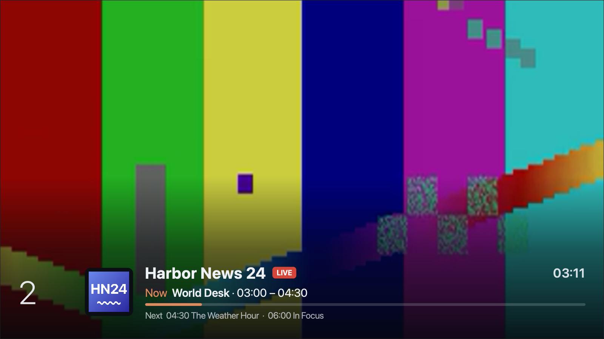
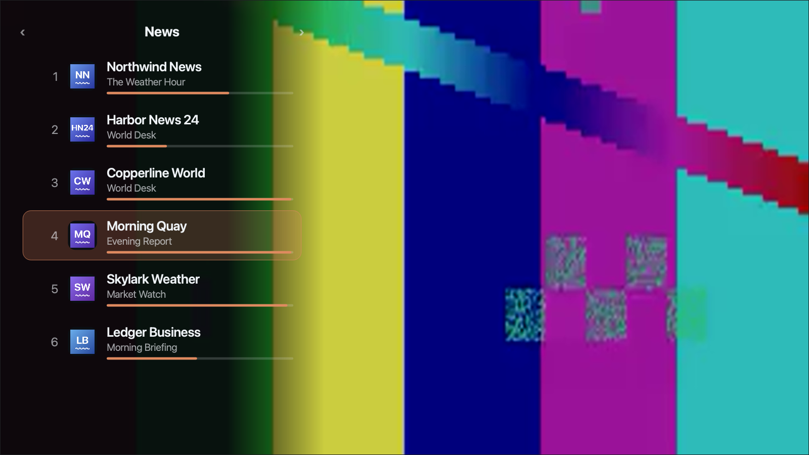
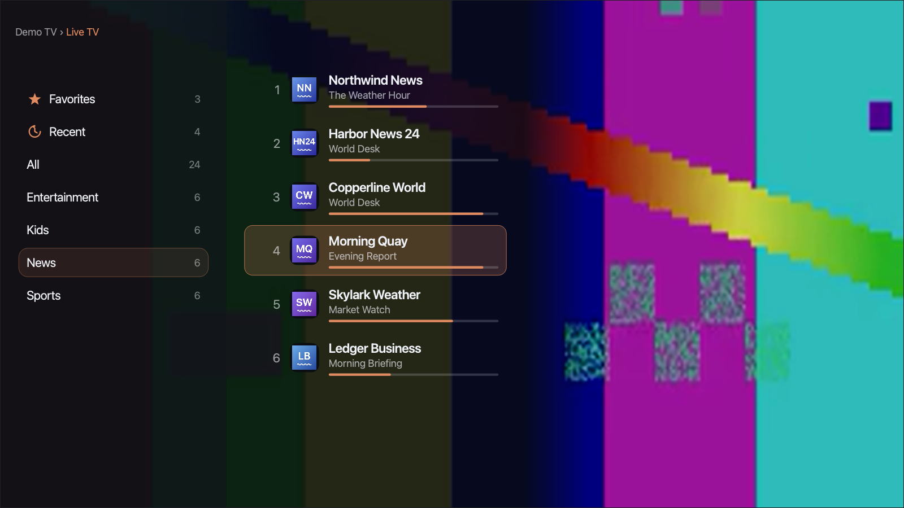
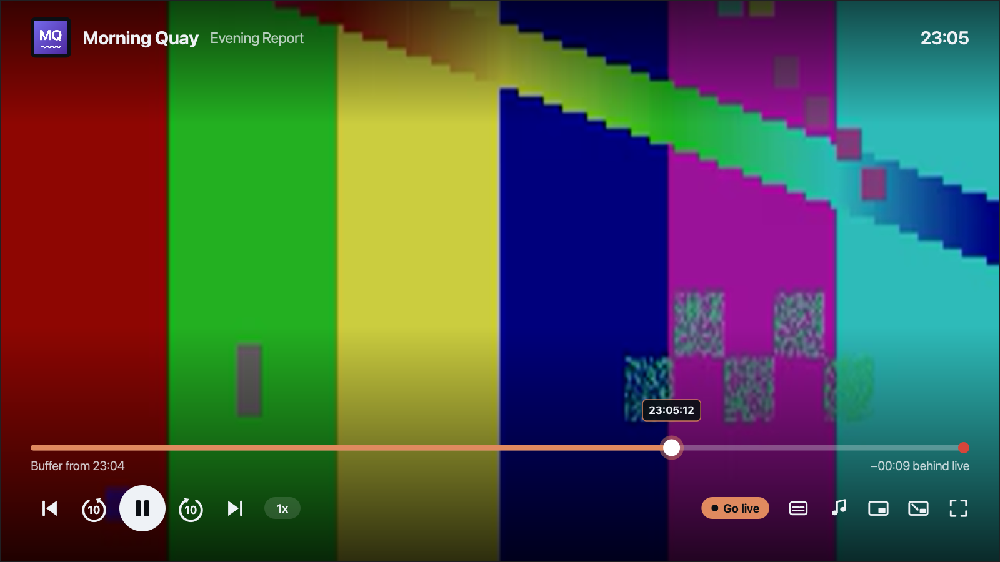
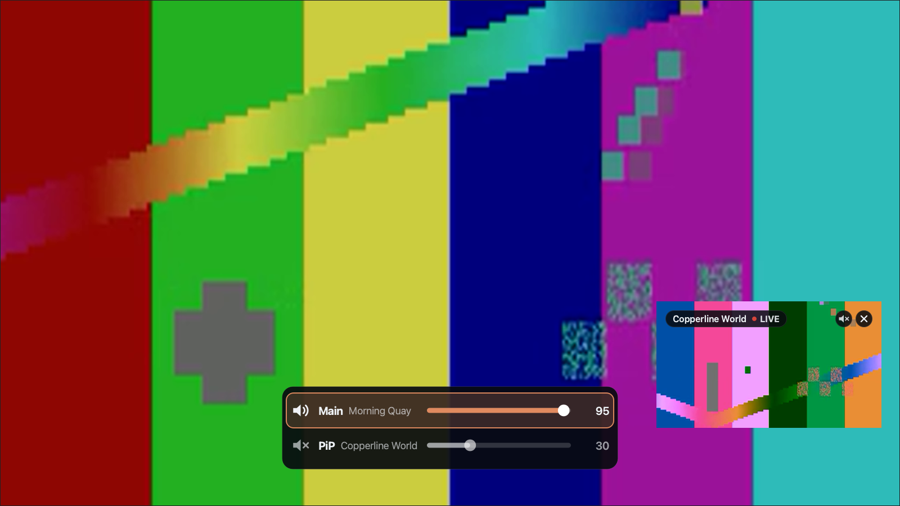
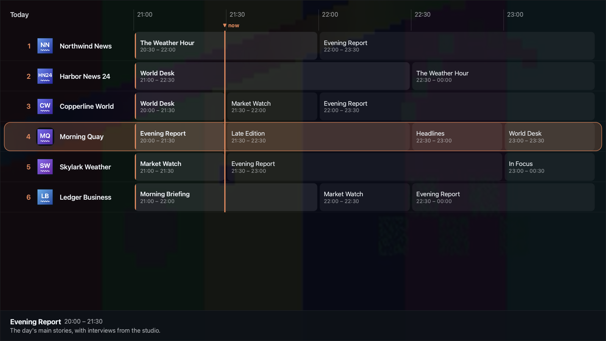
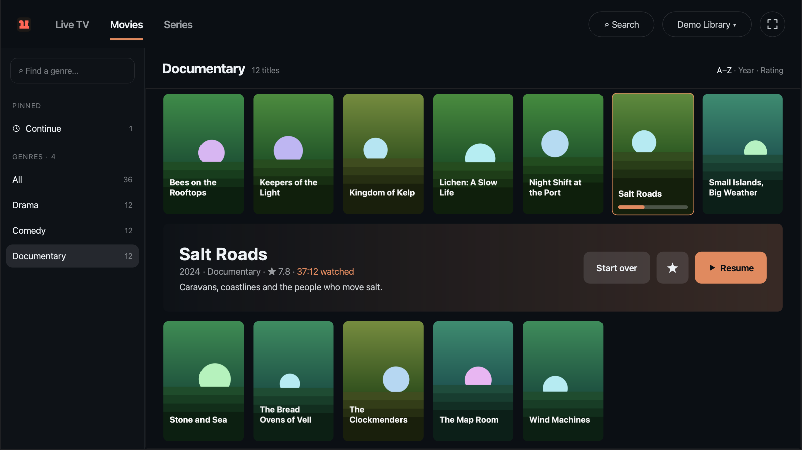
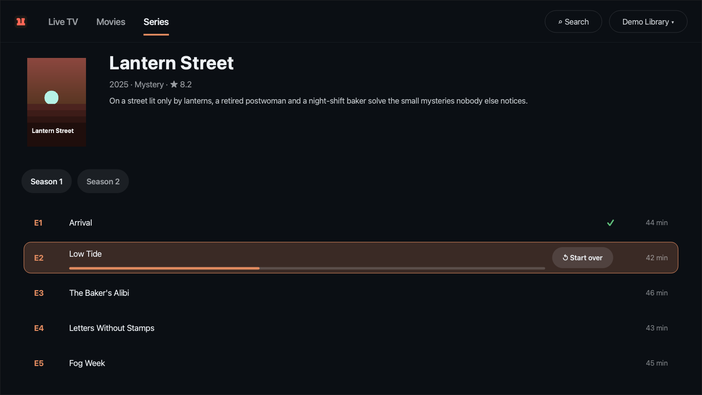

# QiTV - IPTV and STB Client

## Please always download this free software from [RELEASES](https://github.com/ozankaraali/QiTV/releases) instead of using others' distributions, which may have malware.

QiTV is a free TV player for IPTV. It plays M3U playlists (lists of channel links), Xtream accounts (a server address with a username and password) and STB portals (a set-top-box portal address and a MAC address), on Windows, macOS and Linux.

Version 2.0 works like a TV: the channel fills the window, ↑ and ↓ change channels, and everything else (the channel list, the guide, the player controls) slides in over the picture and gets out of the way again. You can pause and rewind live TV, watch two channels at once, and browse movies and series in a Library with posters. Since 2.1, several providers mix in one channel list, one Library and one history, and what plays keeps playing in a corner while you browse. It is written in Python with Qt and plays everything with VLC.



*All screenshots show demo content: the channels, programmes, posters and the test-pattern picture are made up by [`scripts/make_demo_content.py`](scripts/make_demo_content.py).*

## Installing

Download QiTV from [RELEASES](https://github.com/ozankaraali/QiTV/releases):

- **Windows:** `qitv-windows.exe`. Run it; there is nothing to install.
- **macOS:** `qitv-macos-universal.zip` for Apple silicon Macs, `qitv-macos-intel.zip` for Intel Macs. Unzip it and move QiTV to Applications. QiTV needs macOS 13 or newer. QiTV is not notarized by Apple, so the first time macOS may say it cannot check the app: open System Settings → Privacy & Security and choose **Open Anyway**.
- **Linux:** `qitv-linux`. Make it runnable with `chmod +x qitv-linux`, then start it.

VLC comes inside QiTV: you do not need to install VLC to use it.

### Linux Desktop Integration

After downloading the release binary or cloning the repo, you can install QiTV into your application menu so it persists across reboots:

**Using the release binary:**
```bash
chmod +x qitv-linux
git clone https://github.com/ozankaraali/QiTV/  # needed for install script and icon
cd QiTV
./scripts/install-linux.sh /path/to/qitv-linux
```

**Using the source build** (see [Running from source](#running-from-source)):
```bash
./scripts/install-linux.sh
```

This installs a desktop entry and icon so QiTV appears in your application menu. The desktop entry uses absolute paths, so it works after rebooting without needing to re-activate the virtual environment.

**Troubleshooting on Linux:**
- If the release binary fails with Qt/xcb plugin errors, install xcb-cursor: `sudo apt install libxcb-cursor0` (Debian/Ubuntu) or `sudo dnf install xcb-util-cursor` (Fedora).
- Make sure `~/.local/bin` is in your PATH. Add `export PATH="$HOME/.local/bin:$PATH"` to your `~/.bashrc` if needed.

## Adding a provider

On a first start QiTV opens with a [publicly available playlist](https://github.com/iptv-org/iptv) of free channels from around the world, so you can try it straight away. To add your own provider:

1. Press <kbd>Enter</kbd> (or click the picture) to open the channel list.
2. Press <kbd>←</kbd> until you reach the left-most column, the list of your sources (or click your provider's name at the top of the list). With two or more providers, **All providers** is at its top. At its bottom are **⚙ Settings**, **＋ Add provider**, **＋ Free channels…** (iptv-org's free playlist again, for all countries or one country) and **Open file** (a video file on your computer, as <kbd>Ctrl/⌘+O</kbd>).
3. Choose **＋ Add provider**. Settings opens on the Providers tab with a new provider to fill in:
   - **M3U Playlist:** the playlist's web address, or **Load File** for a playlist on your computer;
   - **M3U Stream:** the address of a single stream;
   - **Xtream:** the server address, your username and your password;
   - **STB:** the portal address and your MAC address (serial number and device ID only if your provider asks for them).
4. Press **Verify Provider** to check the details, then **Save**. QiTV loads the channels, and the Library loads the provider's movies and series.

If you delete every provider, including the free playlist, QiTV shows a welcome card whose **Add provider** button does the same; its **Free channels…** button adds iptv-org's free list again, for all countries or one country. Settings is one click away too: the **⚙** at the right end of the channel list's top row (beside it, **↻** loads your provider's channels and guide again, also <kbd>Ctrl/⌘+R</kbd>, and **⌕** searches), or the menu bar (<kbd>Ctrl/⌘+,</kbd>). The same row starts with **‹**, which goes back a level like <kbd>←</kbd>, and the names of where you are: click one to go there. To browse another provider, click your provider's name in that row and pick another in the sources column, or use the **Providers** menu. This only changes what the list shows: what plays keeps playing (see [Several providers](#several-providers)).

QiTV keeps each provider's lists for six hours and refreshes them in the background, so they open at once. If your provider allows only one or two streams at a time, QiTV never opens more: set **Max simultaneous streams** in the provider's settings when QiTV cannot read the limit from the provider. The limit counts per provider.

## Several providers

With two or more providers, QiTV mixes them: every channel, film and series knows the provider it came from and always plays from there, whichever list you found it in.

- **All providers.** The sources column (the channel list's left-most column) starts with **All providers**. It shows ★ Favorites, ⟲ Recent and All with every provider's channels together, each with its provider's name beside it, and then each provider's own groups under its name, named as that provider names them. Groups are never merged, even when two providers use the same name. Typed channel numbers find the first match, in the order of your providers in Settings.
- **Browsing is only browsing.** Picking another provider, or All providers, only changes what the list shows: nothing that plays stops, picture-in-picture stays open, and <kbd>↑</kbd>/<kbd>↓</kbd> keep going through the list the channel was picked from. <kbd>Enter</kbd> (or a click on the picture) opens the list where the big picture's channel was picked: its provider, its group, its row.
- **Two providers at once.** Watch a channel from one account and open one from another in picture-in-picture; swap them and change channels on either. Each provider's stream limit counts on its own, so two accounts that each allow one stream can each play one picture.
- **One history.** ⟲ Recent lists the channels you watched at every provider, newest first, each with its provider's name. <kbd>Backspace</kbd> (the channel before) goes back across providers too, and **Start with the last channel** (Settings) tunes the last channel from its own provider.
- **The guide** of a provider is loaded while its channels are on screen or playing, and let go afterwards, so All providers doesn't download every guide at once.
- **One account's trouble stays with it.** A provider that can't sign in or refresh keeps its saved lists, and the other providers keep working. A channel you play from it says which provider failed and why.
- **The Providers menu** in the menu bar lists your providers with All providers at the top, and ticks the one the channel list shows.

The channel list and the Library each remember the provider (or All providers) you browsed last, also after a restart. With a single provider there is no All providers row, and everything works as before.

## Watching TV

Use the arrow keys like a TV remote: <kbd>↑</kbd> and <kbd>↓</kbd> change the channel, numbers jump to a channel, <kbd>Backspace</kbd> goes back to the channel before, and <kbd>Enter</kbd> opens the channel list. Each change shows a banner with the channel, what is on now and what is next. Hold the key (or press it quickly a few times) and a fast list of the channels around you opens; QiTV tunes the one you stop on.



The channel list has your groups (with ★ Favorites and Recent at the top) on the left and their channels on the right, each with what is on now. Type to filter it. With the mouse: click the picture for the channel list, double-click it for fullscreen, and use the wheel to change channels (or the volume: see Settings → Mouse wheel; <kbd>Ctrl/⌘</kbd> with the wheel always changes the volume). Moving the mouse shows the player controls. Besides play and the speaker they have **⌕** (search), the guide, **⟲** (the channel before) and, at the live edge of a channel you can rewind, **◀10**. On live TV, click the channel's name at the top for what is on, and the **★** beside it to add it to your favorites or remove it. Typing aside, every key in the tables below has a way to do it on screen: a button (its tooltip names the key), a row, the A–Z rail, the mixer's rows, a click, double-click or the wheel on the picture, or the window's own close button.



### Keys

These are also in the app under Help → Keyboard Shortcuts. <kbd>Ctrl/⌘</kbd> means Ctrl on Windows and Linux and ⌘ (Command) on a Mac.

<!-- keys:start -->
**Watching TV**

| Keys | What they do |
| --- | --- |
| <kbd>↑</kbd> / <kbd>↓</kbd> | Previous / next channel (volume during a movie) |
| <kbd>0–9</kbd> | Type a channel number |
| <kbd>Backspace</kbd> | Previous channel |
| <kbd>Enter</kbd> | Channel list |
| <kbd>←</kbd> / <kbd>→</kbd> | Back / forward 10 seconds |
| <kbd>Space</kbd> | Play / pause |
| <kbd>L</kbd> | Go live |
| <kbd>G</kbd> | Guide |
| <kbd>I</kbd> | Channel info |
| <kbd>+</kbd> / <kbd>-</kbd> | Volume up / down (the mixer) |
| <kbd>M</kbd> | Mute |
| <kbd>Tab</kbd> | The mixer's other row (while it shows) |
| <kbd>F</kbd> / <kbd>F11</kbd> / <kbd>⌃⌘F (Mac)</kbd> | Fullscreen |
| <kbd>Ctrl/⌘+F</kbd> | Search |
| <kbd>Ctrl/⌘+D</kbd> | Add or remove a favorite channel |
| <kbd>P</kbd> / <kbd>Ctrl/⌘+P</kbd> | Picture-in-picture with the previous channel, or close it |
| <kbd>S</kbd> | Swap the large and the small picture |
| <kbd>Alt/⌥+P</kbd> | Mini player |
| <kbd>Esc</kbd> | Close what is open, leave fullscreen; after a movie, back to the Library |

**Channel list**

| Keys | What they do |
| --- | --- |
| <kbd>↑</kbd> / <kbd>↓</kbd> | Move |
| <kbd>Page Up</kbd> / <kbd>Page Down</kbd> | Page |
| <kbd>←</kbd> / <kbd>→</kbd> | Layer up / down |
| <kbd>Enter</kbd> | Open or play |
| <kbd>A–Z</kbd> | Type to filter |
| <kbd>Backspace</kbd> | Delete a letter of the filter |
| <kbd>Ctrl/⌘+D</kbd> | Add or remove a favorite channel |
| <kbd>Ctrl/⌘+P</kbd> | Open the channel in picture-in-picture |
| <kbd>Ctrl/⌘+F</kbd> | Search |
| <kbd>F11</kbd> / <kbd>⌃⌘F (Mac)</kbd> | Fullscreen |
| <kbd>Esc</kbd> | Clear the filter, then close |

**Guide**

| Keys | What they do |
| --- | --- |
| <kbd>↑</kbd> / <kbd>↓</kbd> | Move between channels |
| <kbd>←</kbd> / <kbd>→</kbd> | Earlier / later |
| <kbd>0–9</kbd> | Jump to a channel number |
| <kbd>Enter</kbd> | Watch the channel |
| <kbd>Ctrl/⌘+F</kbd> | Search |
| <kbd>F</kbd> / <kbd>F11</kbd> / <kbd>⌃⌘F (Mac)</kbd> | Fullscreen |
| <kbd>G</kbd> / <kbd>Esc</kbd> | Close the guide |

**Movies and Series**

| Keys | What they do |
| --- | --- |
| <kbd>↑</kbd> / <kbd>↓</kbd> / <kbd>←</kbd> / <kbd>→</kbd> | Move |
| <kbd>Enter</kbd> | Play or open |
| <kbd>Home</kbd> / <kbd>End</kbd> | First / last title |
| <kbd>A–Z</kbd> | Jump to a letter, or filter the genres |
| <kbd>Ctrl/⌘+F</kbd> | Search |
| <kbd>/</kbd> | Search, or type it in the search |
| <kbd>Ctrl/⌘+D</kbd> | Add to or remove from My list |
| <kbd>F11</kbd> / <kbd>⌃⌘F (Mac)</kbd> | Fullscreen |
| <kbd>Esc</kbd> | Back; from the genres, back to live TV |

**Anywhere**

| Keys | What they do |
| --- | --- |
| <kbd>Ctrl/⌘+1</kbd> | Live TV |
| <kbd>Ctrl/⌘+2</kbd> | Movies |
| <kbd>Ctrl/⌘+3</kbd> | Series |
| <kbd>Ctrl/⌘+O</kbd> | Open a file |
| <kbd>Ctrl/⌘+,</kbd> | Settings |
| <kbd>Ctrl/⌘+R</kbd> | Refresh channels and guide |
| <kbd>Ctrl/⌘+Q</kbd> | Quit |
<!-- keys:end -->

In the channel list, plain <kbd>P</kbd> types into the filter, so picture-in-picture there is <kbd>Ctrl/⌘+P</kbd>.

### Pause and rewind live TV (time-shift)

QiTV keeps the last few minutes of every live channel you watch, so you can pause, rewind and catch up like with a TV recorder. Press <kbd>Space</kbd> to pause and again to go on from where you paused; <kbd>←</kbd> and <kbd>→</kbd> jump 10 seconds; <kbd>L</kbd> (or **Go live**) goes back to live. The bar shows how far behind live you are. While you are behind, **−** and **+** beside the speed play slower or faster (0.5× to 2×), say faster to catch up; click the speed for normal again. Movies and episodes have the same control.



- **In memory, by default.** Each stream has its own memory for this, set in Settings → Time-shift → **Memory per stream**: 128, 256 (the default) or 512 MiB, about 2, 4 or 9 minutes of HD video.
- **On disk, only if you allow it.** Tick **Use disk for a longer time-shift buffer** in the same tab and choose the size with the slider, from 256 MiB to 16 GiB (2 GiB is about 36 minutes of HD). Only one stream uses the disk at a time; the small picture of picture-in-picture always uses memory. This is temporary history, not a recording: QiTV deletes the oldest part as it goes and everything when you change channel or quit.

### Live latency

Live streams arrive a little behind the broadcast. Settings → **Live latency** chooses how far behind QiTV plays:

- **Auto** (recommended, and the default) learns it for each channel from how the channel's pieces arrive: about 2.5–3.5 seconds for a steady stream, more for one that arrives in uneven pieces or in bursts (never less than one burst). It plays a channel further behind only after the picture ran dry, not for a pause the buffer covered, and quiet minutes bring it closer again. QiTV remembers what it learned per channel for the next time. At the live edge the player controls show how far behind the channel plays, with "adjusted" while trouble holds it further back, for example "Stay live ● ≈ 7 s behind · adjusted".
- **Low** (about 1 second, starts sooner), **Normal** (about 2.5 seconds) or **Stable** (about 6 seconds, for unreliable streams) keep the same distance on every channel. When you update, QiTV moves you to Auto once, whatever you had chosen before; a latency you choose in Settings afterwards stays.

QiTV gently speeds playback up or down to stay there, only when the distance has drifted for a while: a few percent, eased in and out, at most about once every 5 minutes (the dot beside the distance is amber meanwhile). When a channel has fallen far behind (more than about 8 seconds), QiTV jumps closer once instead, at most once a minute, starting where the picture is complete. A channel starts at that distance too, not at the oldest part of what the provider sends; when a provider sends a backlog right after the start, QiTV picks the start again within seconds. On a channel where that does not play smoothly, QiTV notices within a few seconds, plays it at normal speed only and remembers that for a day; then it tries again. Channels that cannot be time-shifted play directly; under Auto they play as with Normal. A few channels whose streams can't be time-shifted smoothly play without rewind too; QiTV notices this by itself and tries again a day later.

### Picture-in-picture

Watch a second channel in a small picture in the bottom-right corner:

- <kbd>P</kbd> (or the player controls' second-channel button) opens the channel you watched before, small; press <kbd>P</kbd> again to close it;
- in the channel list, right-click a channel and choose **Open in picture-in-picture**, or highlight it and press <kbd>Ctrl/⌘+P</kbd>; the channel can come from any of your providers;
- click the small picture or its **⇄**, or press <kbd>S</kbd>, to swap the two: the small one becomes big;
- the sound follows the big picture. The speaker on the small picture turns its sound on or off. <kbd>+</kbd> and <kbd>-</kbd> (or the speaker in the player controls, beside ♪) show the mixer, which sets each picture's volume (<kbd>Tab</kbd> moves to the other row) and hides after a few seconds; without picture-in-picture it shows only the main volume;
- the **×** on the small picture closes it.

Picture-in-picture is for live TV, and it needs two streams: a provider that allows two at a time, or one stream each from two providers. A film or an episode from the Library is the one exception: it takes the big picture and keeps the channel you were watching small (see [Keep watching while you browse](#keep-watching-while-you-browse)).



## The guide

Press <kbd>G</kbd> (or the guide button in the player controls) for the programme guide (EPG): the channels of the group you are watching, from the current half hour on, up to 24 hours ahead. Move with the arrow keys, type a number to jump to a channel, and press <kbd>Enter</kbd> to watch it. With the mouse, click a channel and double-click it to watch; **‹** and **›** beside the day move in time, and **⌕**, **⛶** (fullscreen) and **×** (close) are at the top right. The bottom shows the highlighted programme's description.



The guide comes from your provider (STB and Xtream), or from a guide file or web address of your own (XMLTV): choose it in Settings → EPG.

## The Library: movies and series

<kbd>Ctrl/⌘+2</kbd> opens Movies and <kbd>Ctrl/⌘+3</kbd> Series (also from the channel list's sections). What you were watching keeps playing in a corner (see below); with nothing playing, **Live TV** (or <kbd>Ctrl/⌘+1</kbd>) takes you back to the last channel. While a movie or an episode from the Library plays, **‹ Library** in the player controls (or <kbd>Esc</kbd>) takes you back to where you were in the Library. The **⛶** at the right end of its top bar switches fullscreen.

- **Genres** are on the left. Above them: **Continue** (what you started watching), **New** (the most recently added titles, when your provider says when it added them) and **My list** (titles you saved with ★ or <kbd>Ctrl/⌘+D</kbd>).
- **Posters** fill the rest. The highlighted one opens a strip with its year, genre, rating and story, and **Resume**, **Start over** and ★.
- **Sort** by recently added, A–Z, year or rating. In a long genre, type a letter (or use the A–Z letters on the right edge) to jump there.
- **Providers:** the button with your provider's name at the top right picks whose films and series the Library shows, or, with two or more providers, **All providers**: each provider's genres under its name, and Continue, New and My list mixing every provider (the strip then names a title's provider). This only changes what the Library shows, not the channel list or what plays.
- **Search** (<kbd>Ctrl/⌘+F</kbd> or <kbd>/</kbd>) finds channels, movies and series in the lists QiTV has loaded from all your providers. A hit plays from its own provider, without switching provider first.



A series opens on its seasons and episodes. Episodes you finished have a ✓, and started ones a progress bar with **Start over**. When an episode ends, the next one starts after a 10-second countdown, also across seasons (Settings → Auto-play).



### Keep watching while you browse

Opening the Library or the search (**⌕**, <kbd>Ctrl/⌘+F</kbd>) doesn't stop what plays. The TV shrinks into a corner of the Library, a third of the window wide, with picture-in-picture inside it when it is open, and goes on playing with its sound:

- its buttons are at its top right: the speaker mutes it or turns the sound back on, **⤢** gives it the whole window back, and **×** stops it (the Library stays);
- drag it to another corner if it is in the way; QiTV remembers the corner;
- a click on it, **⤢**, **Live TV** (<kbd>Ctrl/⌘+1</kbd>) or <kbd>Esc</kbd> from the genres brings the TV back exactly as it was: nothing restarts, and rewound live TV is still where you left it;
- a film or an episode you play takes the big picture and keeps the channel you were watching in the small one (a small picture that was already open closes: QiTV has two players). If the film's provider has no stream to spare, QiTV closes the small picture from that provider and tells you;
- a channel you pick in the search plays in the big picture; the small one stays.

## Favorites

Press <kbd>Ctrl/⌘+D</kbd> on a channel, right-click it in the channel list, or click the **★** beside its name in the player controls, to add it to or remove it from **★ Favorites** at the top of the channel list. In the Library, <kbd>Ctrl/⌘+D</kbd> and ★ do the same for **My list**.

A star belongs to one provider and is kept by name: starring a channel called "News" at one provider doesn't star a "News" at another, while within one provider two items with the same name share one star. A provider's ★ Favorites and My list show its own stars; All providers shows every provider's, each with its provider's name. Stars from QiTV 2.0 and earlier stay on every provider that has something of that name; un-star one at one provider and the others keep theirs.

## Exporting to M3U

File → **Export** saves channels, movies or episodes as an M3U playlist for VLC or other players:

- **Cached Content…** saves what QiTV has loaded of the section you are in (live TV, movies or series);
- **All Live Channels…** saves every live channel of the provider;
- **Complete Series (Fetch All)…** (STB providers, in Series) first loads every season and episode. A message shows how far it is; <kbd>Esc</kbd> cancels it.

The exported files contain the stream addresses, which VLC and most players can open directly.

## Playing in another player

Any channel, movie or episode can go to VLC or MPV (when they are installed):

- right-click a channel in the channel list, or a film's poster or an episode in the Library: **Play in VLC** and **Play in MPV** open it in those players, and **Copy stream link** copies its address;
- while it plays, the **Open in external player** button on the right of the player controls (a box with an arrow) offers **Play in VLC** and **Play in MPV**.

QiTV closes its own stream first, so a provider that allows one stream still works.

To open every channel in one of them instead of on the TV screen, turn on **Always play in VLC** or **Always play in MPV** in Settings.

## Portable mode

By default, QiTV stores its settings and cache files in your user folder:
- **Windows**: `%APPDATA%\qitv`
- **macOS**: `~/Library/Application Support/qitv`
- **Linux**: `~/.config/qitv`

To enable **portable mode** (useful for USB drives or keeping everything in one folder), create an empty file named `portable.txt` in the same folder as the QiTV program (or beside `main.py` when running from source). QiTV then keeps all its settings and cache files in that folder instead.

## Running from source

<details>
<summary>Build and run QiTV from the source code</summary>

Running from source needs Python 3.14 and VLC installed on your computer (from [videolan.org](https://www.videolan.org/vlc/), or your Linux distribution's `vlc` package): unlike the release downloads, the source code does not include VLC. Python 3.15 is not yet supported by the Qt and theme libraries.

```bash
git clone https://github.com/ozankaraali/QiTV/
cd QiTV
python3.14 -m venv venv
source venv/bin/activate
pip install -r requirements.txt
python main.py
```

Or with [uv](https://docs.astral.sh/uv/): `uv sync --frozen --dev`, then `uv run python main.py`. The tests run with `uv run python -m unittest discover -s tests`.

To try QiTV without a provider, `uv run python scripts/make_demo_content.py --out build/demo --serve` serves the demo content on your computer and prints how to start QiTV with it. `--screenshots docs/screenshots` instead of `--serve` takes this page's screenshots again.

</details>

### Debug switches

<details>
<summary>Environment variables for troubleshooting</summary>

Set these before starting QiTV (for example `QITV_DEBUG_QT=1 python main.py`):

- `QITV_VLC_LOG=/path/to/vlc.log` writes VLC's detailed log to that file. **This log is not cleaned up: it contains the addresses of the streams you play, which often include your provider username and password. Never share it publicly.**
- `QITV_DEBUG_QT=1` prints Qt's warnings about timers and threads to the terminal.
- `QITV_DEBUG_CURL=1` logs the guide requests QiTV sends to an STB portal as `curl` commands you can run yourself, with the cookies (your MAC address, serial number and device ID) and the session token masked. `QITV_DEBUG_CURL=raw` logs them unmasked: never share that output.

</details>

## Disclaimer

This application bundles [a list of publicly available IPTV channels](https://github.com/iptv-org/iptv) from around the world. The channels are not hosted by this application or respective repository. The application simply creates a convenient way to browse a publicly available media database. The developer of this application has no affiliation with the content providers. The content provided can be removed at any time and we have no control over it. The developer assumes no liability and is not responsible for any legal issues caused by the misuse of this application.

No video files are stored in this repository, the application bundles open-sourced [iptv-org](https://github.com/iptv-org/iptv) playlist for quick startup, users can delete that playlist entry if they want to from their computer. If any links/channels in this application infringe on your rights as a copyright holder, they may be removed by sending a [pull request](https://github.com/iptv-org/iptv/pulls) or opening an [issue](https://github.com/iptv-org/iptv/issues/new?assignees=freearhey&labels=removal+request&template=--removal-request.yml&title=Remove%3A+). However, note that we have **no control** over the destination of the link, and just removing the link from the playlist will not remove its contents from the web. Note that linking does not directly infringe copyright because no copy is made on the site providing the link, and thus this is **not** a valid reason to send a DMCA notice to GitHub. To remove this content from the web, you should contact the web host that's actually hosting the content (**not** GitHub, nor the maintainers of this repository).

## Contributing

Pull requests are welcome. For major changes, please open an issue first to discuss what you would like to change.

If you want to change any function, feel free to do. You could refactor, propose architecture changes, design assets, add new features, provide CI/CD things and build for other platforms. Basically, all changes that can improve this software are welcome.

Dependency versions are maintained in `pyproject.toml` and `uv.lock`. Use `uv sync --frozen --dev` for the locked development environment. After updating dependencies, regenerate the hash-pinned runtime installation file rather than editing it by hand:

```bash
uv export --frozen --no-dev --no-emit-project --output-file requirements.txt
```

## Licensing

QiTV is licensed under [MIT](LICENSE). The release downloads also contain other people's software, each under its own license. [THIRD-PARTY-NOTICES.md](THIRD-PARTY-NOTICES.md) lists them all, and the license texts are in [licenses/](licenses/) (both are inside the downloads too).

- **VLC (libVLC and its plugins):** libVLC is licensed under the LGPL-2.1-or-later; some VLC plugins are under the GPL-2.0-or-later. QiTV ships VLC's own build unchanged. VLC's source code is at [videolan.org/vlc](https://www.videolan.org/vlc/) and [code.videolan.org/videolan/vlc](https://code.videolan.org/videolan/vlc).
- **Qt and PySide6:** used under the LGPLv3. See the [Qt licensing page](https://www.qt.io/licensing/).
- **Python:** the CPython 3.14 runtime (PSF-2.0) and the libraries its build includes, such as OpenSSL (Apache-2.0), libffi, bzip2, xz, SQLite, Expat, mpdecimal, Zstandard and zlib. THIRD-PARTY-NOTICES.md lists each with its version and license.
- **Python libraries** (each license as its package states it):

| Library | License |
| --- | --- |
| aiohttp | Apache-2.0 AND MIT |
| m3u8 | MIT |
| mpv | GPLv2+ or LGPLv2.1+ |
| orjson | MPL-2.0 AND (Apache-2.0 OR MIT) |
| packaging | Apache-2.0 OR BSD-2-Clause |
| pycryptodomex | BSD, Public Domain |
| PyQtDarkTheme-fork | MIT |
| PySide6 | LGPL-3.0-only OR GPL-2.0-only OR GPL-3.0-only |
| python-vlc | LGPL-2.1+ |
| requests | Apache-2.0 |
| tzlocal | MIT |
| urllib3 | MIT |
| URLObject | Public Domain |

QiTV 1.14.x bundled MPV (GPLv3); 2.0 does not.
