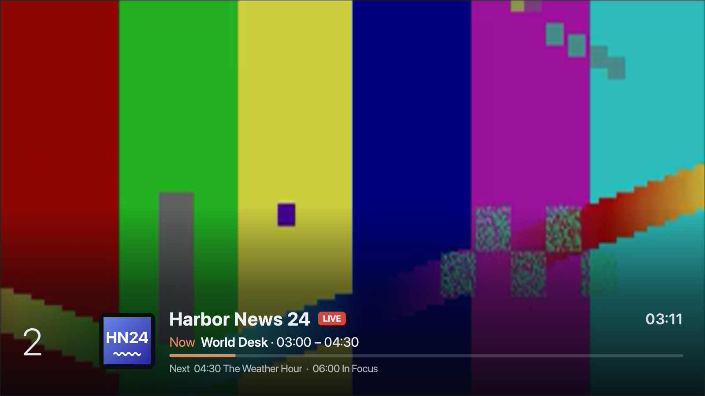
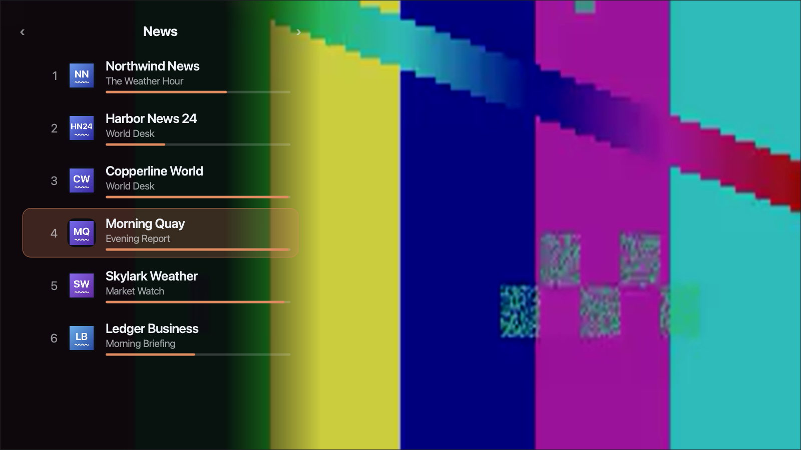
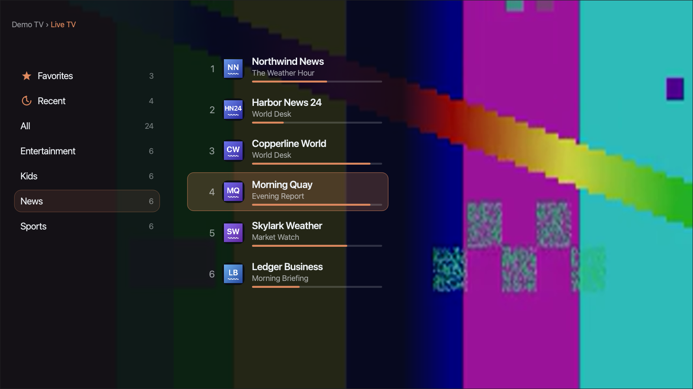
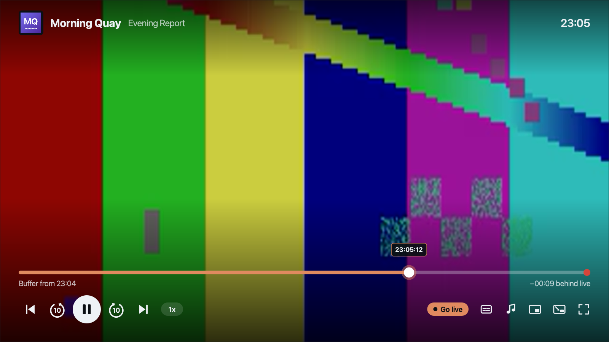
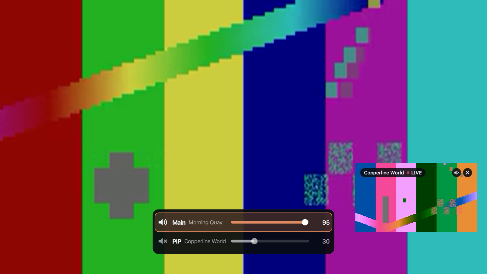
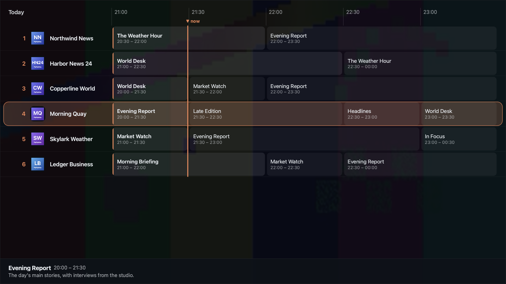
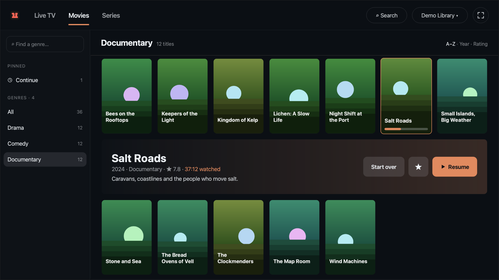
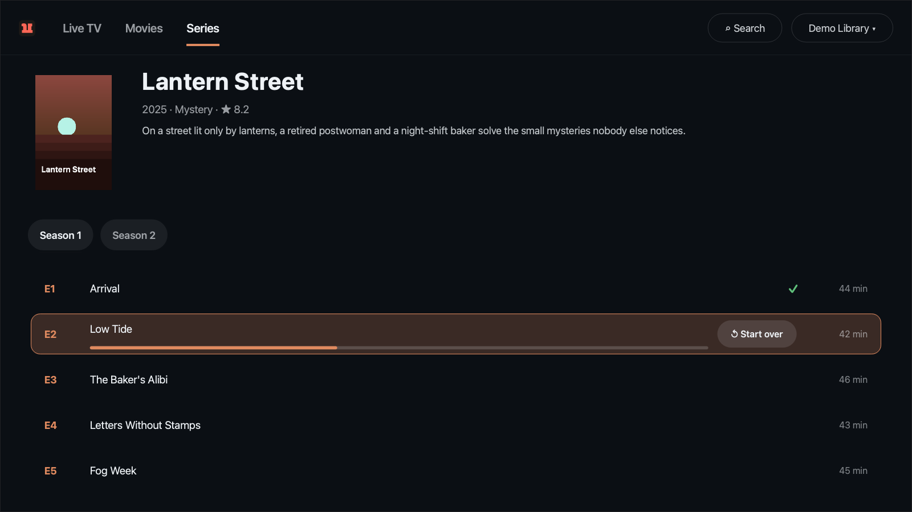

# QiTV - IPTV and STB Client

## Please always download this free software from [qitv.app](https://qitv.app), its website, or [RELEASES](https://github.com/ozankaraali/QiTV/releases) instead of using others' distributions, which may have malware.

QiTV is a free TV player for IPTV. It plays M3U playlists (lists of channel links), Xtream accounts (a server address with a username and password) and STB portals (a set-top-box portal address and a MAC address), on Windows, macOS and Linux.

Version 2.0 works like a TV: the channel fills the window, ↑ and ↓ change channels, and everything else (the channel list, the guide, the player controls) slides in over the picture and gets out of the way again. You can pause and rewind live TV, watch two channels at once, and browse movies and series in a Library with posters. Since 2.1, several providers mix in one channel list, one Library and one history, and what plays keeps playing in a corner while you browse. Since 2.11 it also plays the videos and music on your computer (see [Your own videos and music](#your-own-videos-and-music)). It is written in Python with Qt and plays everything with VLC.



*All screenshots show demo content: the channels, programmes, posters and the test-pattern picture are made up by [`scripts/make_demo_content.py`](scripts/make_demo_content.py).*

## Installing

Download QiTV from [RELEASES](https://github.com/ozankaraali/QiTV/releases):

- **Windows:** `qitv-windows.exe`. Run it; there is nothing to install. QiTV is not signed, so the first time Windows may say "Windows protected your PC": choose **More info**, then **Run anyway**.
- **macOS:** `qitv-macos-universal.dmg` for Apple silicon Macs, `qitv-macos-intel.dmg` for Intel Macs. Open it and drag QiTV onto Applications (the same app also comes as a `.zip`). To update, Help → Check for Updates downloads the new `.dmg`, opens it and closes QiTV: drag QiTV onto Applications again and choose **Replace**. QiTV needs macOS 13 or newer. QiTV is not notarized by Apple, so the first time macOS may say it cannot check the app: open System Settings → Privacy & Security and choose **Open Anyway**.
- **Linux:** `qitv-linux`. Make it runnable with `chmod +x qitv-linux`, then start it. QiTV needs glibc 2.38 or newer: Ubuntu 24.04, Debian 13, Fedora 39 or newer.

VLC comes inside QiTV: you do not need to install VLC to use it. On macOS and Windows it is VideoLAN's own build of the current VLC 3.0 release, taken when the app is built; on Linux it is the distribution's VLC, the libVLC packages of the Linux system the app is built on.

### Linux Desktop Integration

After downloading the release binary or cloning the repo, you can install QiTV into your application menu so it persists across reboots:

**Using the release binary:**
```bash
chmod +x qitv-linux
git clone https://github.com/ozankaraali/QiTV/  # needed for install script and icon
cd QiTV
./scripts/install-linux.sh /path/to/qitv-linux
```

**Using the source build** (see [Running from source](#running-from-source)):
```bash
./scripts/install-linux.sh
```

This installs a desktop entry and icon so QiTV appears in your application menu. The desktop entry uses absolute paths, so it works after rebooting without needing to re-activate the virtual environment.

**Troubleshooting on Linux:**
- If the release binary does not start and says ``version `GLIBC_2.38' not found``, your Linux is older than the libraries inside QiTV need (glibc 2.38: Ubuntu 24.04, Debian 13, Fedora 39 or newer). On an older one, [run QiTV from source](#running-from-source).
- If the release binary fails with Qt/xcb plugin errors, install xcb-cursor: `sudo apt install libxcb-cursor0` (Debian/Ubuntu) or `sudo dnf install xcb-util-cursor` (Fedora).
- Make sure `~/.local/bin` is in your PATH. Add `export PATH="$HOME/.local/bin:$PATH"` to your `~/.bashrc` if needed.

## Adding a provider

On a first start QiTV opens with a [publicly available playlist](https://github.com/iptv-org/iptv) of free channels from around the world, so you can try it straight away. To add your own provider:

1. Press <kbd>Enter</kbd> (or click the picture) to open the channel list.
2. Press <kbd>←</kbd> until you reach the left-most column, the list of your sources (or click your provider's name at the top of the list). With two or more providers, **All providers** is at its top; once a link has played, **Network streams** comes after your providers (see [Open a link](#open-a-link)). At its bottom are **⚙ Settings**, **＋ Add provider**, **＋ Free channels…** (iptv-org's free playlist again, for all countries or one country), **＋ Free radio…** (internet radio, see [Free radio](#free-radio)), **Open file** (a video or music file on your computer, as <kbd>Ctrl/⌘+O</kbd>), **Open a link** (a single stream's link, as **File → Open Link…**) and **Open a folder** (as <kbd>Ctrl/⌘+Shift+O</kbd>; see [Your own videos and music](#your-own-videos-and-music)).
3. Choose **＋ Add provider**. [Settings](#settings) opens beside the picture at **Providers**, with the **Add a provider** card over it. The card has one field, **Link or address**, with **Paste**: paste the link or the address your provider gave you, and the line under the field says what QiTV found ("✓ Xtream at …"). Only the fields that kind needs follow:
   - **Xtream:** a link with your username and password in it (`get.php?username=…&password=…` or `player_api.php?…`) fills in the server, the username and the password, each in its own field; a server's address with a username and password typed in is Xtream too;
   - **M3U playlist:** the playlist's web address (one ending in .m3u or .m3u8, or an address with no username), or **M3U file…** for a playlist on your computer;
   - **STB portal:** a portal address with `/c/` or `/stalker_portal/` in it, or any address with **STB portal** picked under the field; then your MAC address (serial number and device ID only if your provider asks for them);
   - **Jellyfin** or **Emby:** your media server's address (for example `http://192.168.1.20:8096`) with **Jellyfin** or **Emby** picked under the field, then your username and your password. QiTV keeps the sign-in the server gives it, not your password (see [Jellyfin and Emby](#jellyfin-and-emby));
   - **Plex:** pick **Plex** under the field. A card shows a code: enter it at [plex.tv/link](https://plex.tv/link) on any phone or computer, and QiTV adds your Plex server (with several, you pick one). Nothing is typed into QiTV, and your Plex password is never seen; QiTV keeps the server's access on this computer only (see [Plex](#plex)).

   The name is optional: by default, the server's. **Free channels…** under the field adds iptv-org's free list, and **Free radio…** a list of internet radio stations.

   You can also drop a playlist file (.m3u or .m3u8) with web links in it, or a provider's link, onto the QiTV window: it becomes a provider at once and the channel list switches to it (a portal's link without its MAC opens the Add card filled in, waiting for the MAC). A single stream's link dropped there, or an `.m3u8` web link (which may be one stream), opens **Open a link** instead; when it turns out to be a list of channels, the card offers to add it as a provider. A subtitle file dropped at the same time still goes to what plays. A playlist of files on your computer plays instead (see [Folders and playlists](#folders-and-playlists)).
4. Press **Check and add**: QiTV asks the provider first, then adds it and loads the channels, and the Library loads the provider's movies and series. A check that fails says why and offers **Add anyway**, except for Jellyfin and Emby, which need their sign-in, and for a playlist file that isn't there. Adding always makes a new provider.

Each provider has its rows in **Settings → Providers**: its **Name** (changed in place), its **Kind**, **Address and login** (a card), **Verify certificates**, **Streams at once**, **Guide time offset**, **Hidden groups**, **Check the connection** (it asks the provider whether it answers, without opening a stream) and **Remove provider…** (asked first). In **Address and login**, nothing about who the provider is changes until **Check and save** has its answer: the same server and account with a new password or a port fixed is checked, then saved; another kind of provider can only be added as a new one; another server, another account or another playlist address asks whether to **Add as new** or **Replace** the provider's address or login. So a link pasted into an Xtream account never turns it into another provider. A Jellyfin or Emby server signs in again there, and a Plex server shows a new code to enter at plex.tv/link. While parental controls are locked, renaming or removing a provider asks for the PIN.

When a channel or a film doesn't open, or a provider can't be reached, QiTV asks the provider's account why (without opening a stream, at most once a minute) and says it in plain words: the subscription has expired, all the streams the account allows are in use ("Your account allows 1 stream; one is in use"), the username or password is wrong, the server refused or blocked QiTV, or it didn't answer. When QiTV's other picture is the one using the account's only stream, it says that instead. **Check and add** and **Check the connection** say the same: an expired, disabled or refused account doesn't pass, and a portal whose profile shows an end date in the past passes with a note (some portals keep old dates).

If you delete every provider, including the free playlist, QiTV shows a welcome card whose **Add provider** button opens the same card (its **Cancel** brings the welcome card back); its **Free channels…** button adds iptv-org's free list again, for all countries or one country, and its **Free radio…** button a list of internet radio stations. Settings is one click away too: the **⚙** at the right end of the channel list's top row (beside it, **↻** loads your provider's channels and guide again, also <kbd>Ctrl/⌘+R</kbd>, **⌕** searches, and the clapperboard opens the Library at Movies or the section you opened last, as <kbd>Ctrl/⌘+2</kbd>; a provider's own Movies and Series rows open the Library on that provider), or **Settings…** in the menu bar (<kbd>Ctrl/⌘+,</kbd>). The same row starts with **‹**, which goes back a level like <kbd>←</kbd>, and the names of where you are: click one to go there. To browse another provider, click your provider's name in that row and pick another in the sources column, or use the **Providers** menu. This only changes what the list shows: what plays keeps playing (see [Several providers](#several-providers)).

QiTV keeps each provider's lists for six hours and refreshes them in the background, so they open at once. If your provider allows only one or two streams at a time, QiTV never opens more: set **Streams at once** in the provider's rows in Settings → Providers when QiTV cannot read the limit from the provider. The limit counts per provider.

### Free radio

**＋ Free radio…** adds internet radio from [radio-browser.info](https://www.radio-browser.info), a free directory of stations run by its community, the way Free channels adds iptv-org's lists: **All countries** (the 2,000 most played stations in the world), your region, or one country (its stations), from the list of countries in Settings → Providers that each of these places opens (every country from A to Z in your language; type to find one). The **Providers** menu offers All countries and your region at once, and **Another country…** opens that list. A list's first group, **All stations**, holds every station, the most played first; then come its countries (All countries) or its genres (one country: Pop, Rock, News & talk, Classical and so on, from the tags the directory gives them; a station without tags is under Other, the last group). It is in the sources column, the **Providers** menu, Settings → Providers, the Add provider card and the welcome card. A station plays live, straight from the station (no rewind or recording), on the audio screen with its logo, and with the song now playing when the station sends its name. Each list is a provider like any other: remove it in Settings → Providers. QiTV only asks the directory for its lists, as QiTV; nothing of yours is sent.

## Several providers

With two or more providers, QiTV mixes them: every channel, film and series knows the provider it came from and always plays from there, whichever list you found it in.

- **All providers.** The sources column (the channel list's left-most column) starts with **All providers**. It shows ★ Favorites, ⟲ Recent and All with every provider's channels together, each with its provider's name beside it, and then each provider's own groups under its name, named as that provider names them. Groups are never merged, even when two providers use the same name. Typed channel numbers find the first match, in the order of your providers in Settings → Providers.
- **Browsing is only browsing.** Picking another provider, or All providers, only changes what the list shows: nothing that plays stops, picture-in-picture stays open, and <kbd>↑</kbd>/<kbd>↓</kbd> keep going through the list the channel was picked from. <kbd>Enter</kbd> (or a click on the picture) opens the list where the big picture's channel was picked: its provider, its group, its row.
- **Two providers at once.** Watch a channel from one account and open one from another in picture-in-picture; swap them and change channels on either. Each provider's stream limit counts on its own, so two accounts that each allow one stream can each play one picture.
- **One history.** ⟲ Recent lists the channels you watched at every provider, newest first, each with its provider's name. Right-click one there for **Remove from Recents** (or highlight it and press <kbd>Delete</kbd>), or **Clear Recents** to empty the list (also on ⟲ Recent itself). <kbd>Backspace</kbd> (the channel before) goes back across providers too, and **Start with the last channel** (Settings → Playback) tunes the last channel from its own provider.
- **The guide** of a provider is loaded while its channels are on screen or playing, and let go afterwards, so All providers doesn't download every guide at once.
- **One account's trouble stays with it.** A provider that can't sign in or refresh keeps its saved lists, and the other providers keep working. A channel you play from it says which provider failed and why.
- **The Providers menu** in the menu bar lists your providers with All providers at the top, and ticks the one the channel list shows.

The channel list and the Library each remember the provider (or All providers) you browsed last, also after a restart. With a single provider there is no All providers row, and everything works as before.

## Open a link

**File → Open Link…**, or the channel list's **Open a link** row, opens a card with one field and **Paste**: paste a single stream's link and press **Play** (or <kbd>Enter</kbd>). Under the link QiTV says what it is:

- **A live stream** plays as a channel does (with time-shift when it can) and goes into ⟲ Recent.
- **A film** (a file such as `.mp4` or `.mkv`, or an HLS stream that ends) plays as a film and goes on where you stopped, also when its link comes back with a new token.
- **An Xtream stream's link** (one channel or film of an account) plays as that one stream; the card also offers **Add the whole account**. A link of one of your Xtream accounts counts against that account's streams, as its channels do.
- **A whole provider** (an Xtream account's link, an M3U playlist, a portal) says "This is a whole provider, not one stream", and **Add as a provider…** opens the Add card filled in.

An `.m3u8` link, or another web address only its first bytes tell, is read once when you press Play (never while you type, and at most its first 64 KB), to tell a live stream from a film or a list of channels. A link to a provider that allows only so many streams is never read first: it plays at once. A stream's link dropped onto the window opens the card filled in. With no provider yet, a link plays as a file does: the welcome card waits until it ends.

### Network streams

Every link that played is kept in **Network streams**, which the sources column shows after your providers once it has a link. Its rows say "Live", "Film · stopped at 41:12" or, when the link didn't play, why ("Didn't open last time (…)"), and the channel list's find finds them by name.

- **Channel up and down** (<kbd>↑</kbd>/<kbd>↓</kbd>, the media keys, the phone's rocker, the wheel over the picture) step through Network streams while one of its links plays, round from the last to the first. A film link plays as a film, where <kbd>↑</kbd>/<kbd>↓</kbd> are the volume; one link alone steps nowhere.
- **The same stream with a fresh token is the same link:** opening it again updates that link's address, with no second copy, and a film keeps where it stopped. A link that fails is kept with why; QiTV tries it again by itself once at most, and choosing it again opens it anew.
- **It is not a provider** and never counts as one: with a single provider, QiTV stays as it was, with no All providers and no provider names on rows.
- **Settings → Providers → Network streams** lists the links ("4 links"), then **＋ Open a link…**. Each link has **Play**, **Name**, **Address**, **Kind**, **Last opened** and **Remove…**. A new address for the same stream is kept at once; another stream's asks first: **Keep as a new link**, or **Replace**.

## Settings

Settings opens in the TV window, where the channel list opens, and the picture plays on beside it: choose **Settings…** (<kbd>Ctrl/⌘+,</kbd>), the **⚙** in the channel list's top row or its **⚙ Settings** row (from the Library, QiTV goes back to the TV first). It has two columns: the sections on the left, and the highlighted section's rows on the right. The line at the top says where you are ("‹ Settings › Playback").

- **The sections:** **Providers** (your providers, ＋ Add provider, Free channels and Network streams), **General** (Language, Allow Check for Updates, Enable Channel Logos, Film and series details from TMDB, the TMDB token), **Playback** (Live latency, Hardware video decoding, Deinterlacing, 4K versions, Start with the last channel, Mouse wheel, Play in, Autoplay, and on a Mac Picture in picture), **Subtitles & AI captions**, **Time-shift & recordings**, **Guide**, **Phone remote**, **Parental controls**, **Files** and **Advanced** (Verify SSL certificates, Secure DNS, the detailed log, the image cache).
- **The keys:** <kbd>↑</kbd>/<kbd>↓</kbd> move, and <kbd>→</kbd> or <kbd>Enter</kbd> opens a section. On a row with a value, <kbd>←</kbd>/<kbd>→</kbd> step it and <kbd>Enter</kbd> steps on; on any other row, <kbd>←</kbd> goes back to the sections. <kbd>Esc</kbd>, the mouse's Back and the phone remote's Back go one step up, then close Settings, so the phone's arrows, OK and Back reach every setting.
- **Steppers, not boxes:** a choice steps with **‹ ›** (`Live latency ‹ Auto (recommended) ›`), and a setting that is on or off steps between On and Off. A value other than the default shows in the accent colour. Only the highlighted row shows its help, under it; hovering a row shows it too. With the mouse, a click on a row first highlights it, so you can read its help before anything changes; **‹** and **›** step it, and a click on the highlighted row steps on. A row that opens or does something does it at the first click.
- **Changes apply at once;** there is no Save. Text you type applies on <kbd>Enter</kbd>, and <kbd>Esc</kbd> puts the old text back. As the picture stays in sight, a change to Live latency shows at once. Language, Hardware video decoding and the image cache's size say that they apply when QiTV starts again.
- **Cards:** a value that wouldn't fit a row opens a card over the dimmed picture: Disk cache size (with how far back a 1080p and a 4K channel can then be rewound), the guide's Check for updates every, a PIN, a provider's address and login, a channel's guide matching. A row that opens a list of its own ends in ›; one that deletes something is red, ends in "…" and asks first.
- **Typing finds a setting,** as typing in the channel list finds a channel: the sections whose name has the words, and the rows whose name or help has them, capitals and accents aside, each saying where it is ("Providers › …"). <kbd>Enter</kbd> or a click takes you to it.

Every setting keeps its place in QiTV's settings file, so an older 2.x build reads them as you left them.

## Watching TV

Use the arrow keys like a TV remote: <kbd>↑</kbd> and <kbd>↓</kbd> change the channel, numbers jump to a channel, <kbd>Backspace</kbd> goes back to the channel before, and <kbd>Enter</kbd> opens the channel list. Each change shows a banner with the channel, what is on now and what is next. Hold the key (or press it quickly a few times) and a fast list of the channels around you opens; QiTV tunes the one you stop on.



The channel list has your groups (with ★ Favorites and Recent at the top) on the left and their channels on the right, each with what is on now. To find a genre or a channel, type its name (or click **⌕ Find** above the channels first): the matching genres come first, then the channels, from every provider (with two or more, each says which provider it is from): whole words before parts of words, then the provider you are browsing or watched last, then your favorites. Click or press <kbd>Enter</kbd> to open a genre or play a channel; the last row looks for films and series with those words in the Library. <kbd>Esc</kbd> or **✕** takes the list back to where it was. With the mouse: click the picture for the channel list, double-click it for fullscreen, and use the wheel over the picture to change the volume (over the channel list it changes channels; to change channels over the picture too, see Settings → Playback → Mouse wheel; <kbd>Ctrl/⌘</kbd> with the wheel always changes the volume). Moving the mouse shows the player controls. Besides play, **■** (stop: nothing plays or streams until you play again) and the speaker they have **⌕** (search), the guide, **⟲** (the channel before) and, at the live edge of a channel you can rewind, **◀10**. On live TV the bar also has the clapperboard, **Movies and series** (<kbd>Ctrl/⌘+2</kbd>), which opens the Library section you used last, where a film has its TV button. On live TV, click the channel's name at the top for what is on, the **★** beside it to add it to your favorites or remove it, and the red **●** after that to record the channel (see [Recording](#recording)). Typing aside, every key in the tables below has a way to do it on screen: a button (its tooltip names the key), a row, the A–Z rail, the mixer's rows, a click, double-click or the wheel on the picture, or the window's own close button.

On a Mac in fullscreen, switching to another desktop or app floats the picture in a small window on every desktop, as a browser does on a tab change; drag it anywhere, drag an edge or a corner to resize it (it keeps the picture's shape and remembers its place and size), and double-click it (or come back to the player's desktop) to watch in fullscreen again. It has the mini player's controls: they come as the pointer moves over it, and play, ■, the steps, live, the star, record and the speaker (mute) act there without bringing QiTV forward. Its window button and fullscreen button bring the fullscreen desktop back, and so do Sound, Subtitles, Picture, ⚙, the guide, Search, the Library and the other buttons that open something, which then opens there. It never takes the keyboard (keys stay with the app you are in), and the wheel over it does nothing. Settings → Playback → Picture in picture → Float the picture when you leave a fullscreen desktop turns it off. On a Mac the mini player (<kbd>Alt/⌥+P</kbd> or its button) is a small window of its own on every desktop, with the player controls over it: they come as the pointer moves over it, its clicks and keys are the full window's, its edges resize it in the picture's shape, and the wheel over its picture does nothing. Its button or <kbd>Alt/⌥+P</kbd> brings the window back, as the Library, Search and Settings do, and a double-click goes fullscreen.



### Keys

These are also in the app under Settings › Keys (Help → Keyboard Shortcuts opens it). <kbd>Ctrl/⌘</kbd> means Ctrl on Windows and Linux and ⌘ (Command) on a Mac.

<!-- keys:start -->
**Watching TV**

| Keys | What they do |
| --- | --- |
| <kbd>↑</kbd> / <kbd>↓</kbd> | Previous / next channel (volume during a movie) |
| <kbd>0–9</kbd> | Type a channel number |
| <kbd>Backspace</kbd> | Previous channel |
| <kbd>Enter</kbd> | Channel list |
| <kbd>←</kbd> / <kbd>→</kbd> | Back / forward 10 seconds |
| <kbd>Space</kbd> | Play / pause |
| <kbd>X</kbd> | Stop: nothing plays or streams (Space plays it again) |
| <kbd>L</kbd> | Go live |
| <kbd>R</kbd> | Record the channel, or stop recording |
| <kbd>G</kbd> | Guide |
| <kbd>I</kbd> | Channel info |
| <kbd>+</kbd> / <kbd>-</kbd> | Volume up / down (the mixer) |
| <kbd>M</kbd> | Mute |
| <kbd>Tab</kbd> | The mixer's other row (while it shows) |
| <kbd>Tab</kbd> / <kbd>Shift+Tab</kbd> | Multiview: focus the next / previous tile |
| <kbd>J</kbd> / <kbd>K</kbd> | Sound 50 ms earlier / later (sync with the picture) |
| <kbd>Shift+J</kbd> / <kbd>Shift+K</kbd> | Subtitles 50 ms earlier / later |
| <kbd>A</kbd> | Picture: aspect ratio, sleep timer; pressed again, the next ratio |
| <kbd>Shift+I</kbd> | Statistics over the picture: show or hide |
| <kbd>F</kbd> / <kbd>F11</kbd> / <kbd>⌃⌘F (Mac)</kbd> | Fullscreen |
| <kbd>Ctrl/⌘+F</kbd> | Search |
| <kbd>Ctrl/⌘+D</kbd> | Add or remove a favorite channel |
| <kbd>P</kbd> / <kbd>Ctrl/⌘+P</kbd> | Picture-in-picture with the previous channel, or close it |
| <kbd>S</kbd> | Swap the large and the small picture |
| <kbd>V</kbd> | Multiview: several channels at once, or back to one |
| <kbd>Alt/⌥+P</kbd> | Mini player |
| <kbd>Esc</kbd> | Close what is open, leave the multiview or fullscreen; after a movie, back to the Library |

**Channel list**

| Keys | What they do |
| --- | --- |
| <kbd>↑</kbd> / <kbd>↓</kbd> | Move |
| <kbd>Page Up</kbd> / <kbd>Page Down</kbd> | Page |
| <kbd>←</kbd> / <kbd>→</kbd> | Layer up / down |
| <kbd>Enter</kbd> | Open or play |
| <kbd>A–Z</kbd> | Find a genre or channel (every provider) |
| <kbd>Backspace</kbd> | Delete a letter of the find |
| <kbd>Ctrl/⌘+D</kbd> | Add or remove a favorite channel |
| <kbd>Ctrl/⌘+P</kbd> | Open the channel in picture-in-picture |
| <kbd>Delete (fn+⌫ on a Mac)</kbd> | Remove the channel from Recents |
| <kbd>Menu</kbd> / <kbd>Shift+F10</kbd> | Open the highlighted item's menu (as a right-click does) |
| <kbd>Ctrl/⌘+F</kbd> | Search |
| <kbd>F11</kbd> / <kbd>⌃⌘F (Mac)</kbd> | Fullscreen |
| <kbd>Esc</kbd> | End the find, then close |

**Guide**

| Keys | What they do |
| --- | --- |
| <kbd>↑</kbd> / <kbd>↓</kbd> | Move between channels |
| <kbd>←</kbd> / <kbd>→</kbd> | Earlier / later |
| <kbd>Home</kbd> | Now |
| <kbd>0–9</kbd> | Jump to a channel number |
| <kbd>Enter</kbd> | Watch the channel; a past programme from its start |
| <kbd>R</kbd> | Record the programme at its time, or cancel its recording |
| <kbd>Menu</kbd> / <kbd>Shift+F10</kbd> | Open the highlighted item's menu (as a right-click does) |
| <kbd>Ctrl/⌘+F</kbd> | Search |
| <kbd>F</kbd> / <kbd>F11</kbd> / <kbd>⌃⌘F (Mac)</kbd> | Fullscreen |
| <kbd>G</kbd> / <kbd>Esc</kbd> | Close the guide |

**Movies and Series**

| Keys | What they do |
| --- | --- |
| <kbd>↑</kbd> / <kbd>↓</kbd> / <kbd>←</kbd> / <kbd>→</kbd> | Move |
| <kbd>Enter</kbd> | Play or open |
| <kbd>Home</kbd> / <kbd>End</kbd> | First / last title |
| <kbd>A–Z</kbd> | Type to search every provider's movies, series and channels |
| <kbd>Ctrl/⌘+F</kbd> | Search |
| <kbd>/</kbd> | Search, or type it in the search |
| <kbd>Ctrl/⌘+D</kbd> | Add to or remove from My list |
| <kbd>Delete (fn+⌫ on a Mac)</kbd> | Delete a recording (it asks first), or take a folder off Folders |
| <kbd>Menu</kbd> / <kbd>Shift+F10</kbd> | Open the highlighted item's menu (as a right-click does) |
| <kbd>F11</kbd> / <kbd>⌃⌘F (Mac)</kbd> | Fullscreen |
| <kbd>Esc</kbd> | Back; from the genres, back to live TV |

**Finding subtitles**

| Keys | What they do |
| --- | --- |
| <kbd>↑</kbd> / <kbd>↓</kbd> | Move in a list; up from the top to the search field |
| <kbd>Page Up</kbd> / <kbd>Page Down</kbd> | Page |
| <kbd>←</kbd> / <kbd>→</kbd> | Between the languages and the subtitles |
| <kbd>Enter</kbd> | Download and show the subtitles; in the field, search (or save the key) |
| <kbd>A–Z</kbd> | Type what to search for (or the API key) |
| <kbd>Ctrl/⌘+V</kbd> | Paste |
| <kbd>Backspace</kbd> | Delete a letter |
| <kbd>Esc</kbd> | Close |

**Anywhere**

| Keys | What they do |
| --- | --- |
| <kbd>Ctrl/⌘+1</kbd> | Live TV |
| <kbd>Ctrl/⌘+2</kbd> | Movies |
| <kbd>Ctrl/⌘+3</kbd> | Series |
| <kbd>Ctrl/⌘+4</kbd> | Multiview |
| <kbd>Ctrl/⌘+5</kbd> | Recordings |
| <kbd>Ctrl/⌘+O</kbd> | Open a file |
| <kbd>Ctrl/⌘+Shift+O</kbd> | Open a folder |
| <kbd>Ctrl/⌘+,</kbd> | Settings |
| <kbd>Ctrl/⌘+R</kbd> | Refresh channels and guide |
| <kbd>Ctrl/⌘+Shift+R</kbd> | Refresh films and series |
| <kbd>Ctrl/⌘+Q</kbd> | Quit |
<!-- keys:end -->

In the channel list, plain <kbd>P</kbd> types into the filter, so picture-in-picture there is <kbd>Ctrl/⌘+P</kbd>.

### Sound and subtitles

On some channels the sound slowly drifts out of step with the picture. The **♫** button in the player controls opens the **Sound** panel: pick another sound track there when the channel or film has more than one, and use the **Sync** row to move the sound: **−** makes it play earlier and **+** later, 50 milliseconds at a time (up to 5 seconds either way). It reads, for example, "Sound 150 ms later", or "In sync"; **Reset** puts it back. <kbd>J</kbd> and <kbd>K</kbd> do the same from anywhere on the player. QiTV remembers the setting for each live channel, also after a restart, and uses it whenever that channel plays, big or small. For a film or an episode it lasts while that title plays.

The subtitles button beside it opens the **Subtitles** panel: **Off**, the subtitles the stream brings, and **Load a file…** to pick a subtitle file from your computer (.srt, .ass, .ssa, .vtt or .sub; it opens in the folder you used last). You can also drop a subtitle file onto the window while something plays. The file then shows in the list under its own name. While subtitles show, the panel has a **Sync** row too, for subtitles that come too early or too late; <kbd>Shift+J</kbd> and <kbd>Shift+K</kbd> do the same. A subtitle file and its timing last while that film, episode or channel plays.

Click anywhere else, or press <kbd>Esc</kbd>, to close a panel. While one is open, <kbd>↑</kbd> and <kbd>↓</kbd> move through it, <kbd>Enter</kbd> picks, and <kbd>←</kbd> and <kbd>→</kbd> move the sync.

#### Subtitles from OpenSubtitles

For a film or an episode, the Subtitles panel also has **Search OpenSubtitles…**: QiTV looks for subtitles on [OpenSubtitles.com](https://www.opensubtitles.com), a free subtitle website: by the film's or series' TMDB or IMDb number when the provider lists one, else by the title that plays (with the film's year, or the series with its season and episode number; tags such as "EN:", "TR - " or "4K" in a provider's title are left out). Only subtitles made for that film or episode are listed. The languages that have subtitles are on the left with how many each has, your last language (or your computer's) first; the selected language's subtitles are on the right, the best first: from trusted uploaders and downloaded most. **Machine translated** ones are marked and come last; **Hearing impaired** ones are marked and come after the others, unless the last ones you picked were for the hearing impaired. Click one, or press <kbd>Enter</kbd>, and it downloads, shows at once and appears in the Subtitles panel under its own name. If the title is not found (a title translated by the provider often is not), type its original or English title in the search field at the top and press **Search**. When OpenSubtitles finds subtitles only for other titles, it lists them all the same, each with the title it was made for: check it before you pick one. The next time that film or episode plays, the Subtitles panel offers the same file again at its top ("… (OpenSubtitles)"), without a new download.

OpenSubtitles needs an **API key**. The release downloads of QiTV may come with one. If yours does not, the first search asks for one: **Get a free key** opens the OpenSubtitles website, where you make a free account and then create a key on its "API consumers" page; copy the key, click **Paste** (or press <kbd>Ctrl/⌘+V</kbd>) and **Save**. You can change it later in **Settings → Subtitles & AI captions** (**OpenSubtitles API key**).

Without signing in, OpenSubtitles allows 5 downloads a day per internet connection. To get more, enter your OpenSubtitles username and password in **Settings → Subtitles & AI captions** (optional; **Sign out** there removes them). After each download QiTV says how many downloads you have left today and when more come back. Downloaded subtitles are kept in the `subtitles` folder beside QiTV's settings (see [Portable mode](#portable-mode) for where that is).

### Picture, sleep timer and statistics

The picture button beside the subtitles button (or <kbd>A</kbd>) opens the **Picture** panel. Click **‹** or **›** on a row (or use <kbd>←</kbd> and <kbd>→</kbd>) to change it:

- **Aspect ratio**: **Auto** (the channel's own shape), **16:9**, **4:3**, or **Fill the window**, which crops the picture to the window's shape so there are no black bars. QiTV remembers it for each live channel, also after a restart. Pressing <kbd>A</kbd> again while the panel is open moves to the next ratio.
- **Sleep timer**: **15**, **30**, **60** or **90 minutes**, or **End of the programme** when the guide knows when the programme ends. The row shows the time left. A minute before the end QiTV says playback stops soon; click **Keep watching** (or press <kbd>Enter</kbd>) to turn the timer off. Otherwise playback stops, fullscreen ends, and your computer may go to sleep again. The timer is not kept after QiTV closes.
- **Statistics** (or <kbd>Shift+I</kbd>) shows technical details over the picture: the video and audio format, the picture size and frame rate, pictures shown and dropped, the bitrate, hardware or software decoding, whether the channel plays through time-shift, and how far behind live it is.

In picture-in-picture the panel changes the big picture; in the multiview, the selected tile.

### Pause and rewind live TV (time-shift)

QiTV keeps the last few minutes of every live channel you watch, so you can pause, rewind and catch up like with a TV recorder. Press <kbd>Space</kbd> to pause and again to go on from where you paused; <kbd>←</kbd> and <kbd>→</kbd> jump 10 seconds; <kbd>L</kbd> (or **Go live**) goes back to live. The bar shows how far behind live you are. While you are behind, **−** and **+** beside the speed play slower or faster (0.5× to 2×), say faster to catch up; click the speed for normal again. Movies and episodes have the same control.



- **In memory, by default.** Each stream has its own memory for this, set in Settings → Time-shift & recordings → **Memory per stream**: 128, 256 (the default) or 512 MiB, about 2, 4 or 9 minutes of HD video.
- **On disk, only if you allow it.** Turn on **Use disk for a longer time-shift buffer** in the same section and choose **Disk cache size** in its card, from 256 MiB to 16 GiB (2 GiB is about 36 minutes of HD; the card says how far back a 1080p and a 4K channel can then be rewound). The size is the total for every channel's buffer on disk; the small picture of picture-in-picture keeps its buffer in memory, unless its channel's buffer was already kept on disk. This is temporary history, not a recording: when the space is used up, the oldest part goes first.
- **Leaving a channel keeps its buffer.** A zap, another channel, a film or quitting QiTV keeps what the buffer holds. Come back to the channel by any route and it plays live; if you had paused or rewound, **Left off at 20:10 · Resume** shows at the top for 15 seconds (on the phone too): click it, or press <kbd>Enter</kbd>, to go on from there; its **✕**, <kbd>Esc</kbd> or Back closes it. Nothing records a channel you left (providers allow few streams), so the bar shows the time away as a gap, which playback and seeks skip.
- **For a day, and after a restart.** On disk, kept buffers last 24 hours and are still there after quitting QiTV; when the space is used up, the oldest parts of the channels you left go first. In memory, only the channel you left last keeps its buffer, until QiTV quits. Turning the disk buffer off removes what it kept.
- **When the channel can't open.** If a channel you come back to doesn't open (say the provider still counts your last connection), its kept buffer plays all the same; **Go live** tries the channel again.
- **As far back as the channel's server keeps it.** Some live channels' own servers keep hours of the channel, a day for some. On such a channel the bar reaches as far back as the server keeps it (the part before the buffer is dashed), and <kbd>←</kbd>, the bar and **⏮** go back there; so does the guide's **▶ Watch from the start**, on the channel you watch or one you watched earlier. What the buffer holds always plays from the buffer: only what lies before it comes from the server, a minute ahead of what plays, and at the buffer's start playback goes on into the buffer without a break; what came from the server plays again at once until you go live, leave the channel or go back further. With a provider that limits its streams, the live stream pauses meanwhile (the bar shows a gap there) and opens again when you are back in the buffer or go live; while such a channel records, QiTV can't go past the buffer, and before the buffer it can't start a recording (it says so).

### Catch-up: your provider's archive

Many providers keep the last days of some channels, so you can watch what was on earlier. QiTV knows which channels have such an archive from your provider's channel list (Xtream providers, M3U playlists that say so, and STB portals that mark their archived channels), and uses it where its own time-shift buffer ends:

- **Rewind further back.** On a channel with an archive, the time-shift bar reaches half an hour further back than the buffer; that part of the line is dashed. Drag there, press <kbd>←</kbd> at the start of the buffer, or press **⏮** for a programme that began before it, and QiTV plays the provider's archive from that moment ("From the provider's archive"). <kbd>L</kbd> or **Go live** goes back to the live channel.
- **Through the buffer, when it can.** Most archives come as a stream QiTV can buffer. Then the archive plays as part of the channel's own bar (so does the guide's **Watch from the start** on the channel you are watching): the bubble over the knob says which moment plays (with the day, if it is not today), what came of the archive replays at once, and when the archive reaches the buffer's start, playback goes on into the buffer instead of fetching that again. Other archives, an STB portal's recordings and **Watch from the start** on another channel play the archive on a bar of its own, from that time to now, and <kbd>←</kbd>, <kbd>→</kbd>, **⏮** and the bar move within it.
- **Watch a past programme from the start.** In the guide, <kbd>←</kbd> (or **‹**) also goes back in time on such channels. The programme at the left edge of the guide, or a past one you click, is outlined: press <kbd>Enter</kbd>, double-click it, or click **▶ Watch from the start** at the bottom of the guide. That button also plays the programme on now from its beginning.
- **One stream at a time.** The archive is another stream from your provider, so with a provider that limits its streams QiTV pauses (or closes) the live stream before it opens the archive, and the other way round when you go back to live: the archive never takes a stream of its own.
- **Some archives don't answer.** A channel can claim an archive the provider doesn't have. Then QiTV says so and keeps playing (or goes back to live). When the provider says it has nothing twice, for two different times, QiTV doesn't ask for that channel's archive again for three days.

How far back you can go depends on the provider (often one to seven days). An STB portal's archive plays programme by programme: QiTV asks the portal for the recording of the guide's programme at that moment and moves on to the next programme's at its end, so it needs the guide from the portal itself (Settings → Guide → Guide source), and the guide offers only programmes the portal lists as recorded. Portals differ in what they keep and how they answer, so some marked channels may still not play; QiTV then says so and stays live. Archive times follow your provider's time zone, which QiTV reads from Xtream providers when it loads their channels (refresh the channel list once after updating); an M3U playlist's Xtream-style channels use the time zone of your Xtream provider on the same server, else UTC. While the archive plays on a bar of its own, <kbd>R</kbd> doesn't record: recordings come from the live buffer.

### Recording

Press <kbd>R</kbd>, or the red **●** after the channel's name and ★ at the top of the player controls, to record the live channel you are watching; press it again to stop. While it records, the **●** is lit and **● REC 01:23** beside it counts the time.

- **From where you are watching.** If you have paused or rewound, the recording starts there, with what the time-shift buffer holds after it, and then goes on with the live stream.
- **It keeps recording.** The recording keeps the channel's stream for itself and records on through pauses, rewinds, other channels, films and the Library; several channels can record at once, as far as your provider's streams go. While you watch something else, **● REC** with the channel and its time shows at the top right of the picture with the player controls, and for a few seconds by itself when a recording starts or ends (in the Library it stays at the bottom left): click it to go back to the channel, to stop the recording, or for **Manage Recordings…**. Back on the channel, it plays live, and you can rewind to the start of the recording while it still records. Picture-in-picture of that channel shows the recording itself, with no new stream.
- **A stream for what you watch meanwhile.** Another channel, film or episode from the same provider needs another stream. When the provider has none left, QiTV asks whether to stop the recording: **Keep recording** (chosen first, and on the TV what happens when no one answers within a minute) stays where you are; **Stop recording** saves it and goes on. **Play in VLC** or **MPV** and the phone's **Watch** ask the same; the phone's question shows on the phone. A provider that allows one stream without saying so and drops the older one when another opens: QiTV stops the newer stream instead and says so, so the recording goes on.
- **Until you stop it.** It stops when you press <kbd>R</kbd> or the **●** again, from the **● REC** sign, after 24 hours, or when less than 2 GB is left on the disk. Quitting QiTV while it records asks first. A message then says **Recording saved** with the file's name (and why it stopped, if you did not stop it). **■** (stop) leaves recordings going.
- **In your Movies folder, and on the Recordings tab.** Recordings go to **QiTV** in your Movies folder (macOS) or Videos folder (Windows and Linux). **Settings → Time-shift & recordings → Recordings folder** changes the folder and opens it (so does **File → Open Recordings Folder**). The Library's **Recordings** tab shows them as tiles, newest first, each named after its programme with its channel, length and **NEW** until you play it; a tile plays it, from where you stopped (see [Managing recordings](#managing-recordings)). The phone remote's Library lists them under **Recordings**, and watching on the phone a recording plays there, from where you stopped: at home, QiTV hands the file to the phone itself, nothing re-encoded (a channel in HEVC or with only MPEG sound plays on the TV only); one still recording plays as far as it got.
- **As the channel sends it.** Each file is named after the channel and the time, for example `My Channel 2026-10-19 21.30.ts`: an MPEG-TS file with the channel's own picture and sound, not re-encoded, which VLC, MPV and most players play.
- **No new stream to start.** A recording is written from the time-shift buffer of the stream that plays, so starting one never asks your provider for another stream. That is also why a channel that plays without time-shift can't be recorded: its button is dimmed and says so.
- In the multiview the button records the focused tile. A recording goes on when the focus moves, or when its channel becomes the small picture of picture-in-picture: that tile or small picture says **REC** on its label. Changing or closing a tile that records asks first; leaving the multiview keeps its recordings going.

### Deinterlacing

Settings → Playback → **Deinterlacing**: **Auto** deinterlaces only the pictures marked as interlaced and adds nothing on progressive channels, **Off** never deinterlaces. Going back to **Auto** takes effect the next time QiTV starts.

### Live latency

Live streams arrive a little behind the broadcast. Settings → Playback → **Live latency** chooses how far behind QiTV plays:

- **Auto** (recommended, and the default) learns it for each channel from how the channel's pieces arrive: about 2.5–3.5 seconds for a steady stream, more for one that arrives in uneven pieces or in bursts (never less than one burst). It plays a channel further behind only after the picture ran dry, not for a pause the buffer covered, and quiet minutes bring it closer again, but never closer than the room the channel's bursts need. QiTV remembers what it learned per channel for the next time. At the live edge the player controls show how far behind the channel plays, with "adjusted" while trouble holds it further back, for example "Stay live ● ≈ 7 s behind · adjusted" (in a small window "adjusted", then "Stay live", give way first).
- **Low** (about 1 second, starts sooner), **Normal** (about 2.5 seconds) or **Stable** (about 6 seconds, for unreliable streams) keep the same distance on every channel. When you update, QiTV moves you to Auto once, whatever you had chosen before; a latency you choose in Settings afterwards stays.

QiTV gently speeds playback up or down to stay there, only when the distance has drifted for a while and by more than a little: behind it, by more than about 1.5 seconds or 15% of the distance, whichever is larger; ahead of it, by more than 15% (at least a second). It changes speed by a few percent, in one step and back in one, at most about once every 5 minutes (the dot beside the distance is amber meanwhile). Once a channel sends in bursts, QiTV keeps room for them until you change channels. When the provider sends a backlog, QiTV catches it up the same way, 3 or 5 percent faster, rather than skip part of the programme. It jumps closer only after the channel stalled or the picture froze far behind (at most once a minute, starting where the picture is complete), or once when a backlog leaves it more than about 30 seconds behind. A channel starts at that distance too, with the picture at once; when the provider sends a backlog right after the start, QiTV picks the start again once, as soon as the backlog has arrived, and catches up whatever more the start brings. On a channel that has come in bursts, when it goes quiet for longer than its usual gaps, QiTV holds the picture just before it would run dry ("Waiting for the channel…"); on any channel it does so once the picture has run dry in the last 5 minutes. The picture plays on once the channel sends at its pace again, not at a trickle, rather than in fits. On a channel where a change of speed does not play smoothly, QiTV notices within a few seconds, plays it at normal speed only and remembers that for a day; then it tries again. Channels that cannot be time-shifted play directly; under Auto they play as with Normal. A few channels whose streams can't be time-shifted smoothly play without rewind too; QiTV notices this by itself and tries again a day later.

### Picture-in-picture

Watch a second channel in a small picture in the bottom-right corner:

- <kbd>P</kbd> (or the player controls' second-channel button) opens the channel you watched before, small; with none before it, the channel list opens and the channel you pick there opens small; press <kbd>P</kbd> again to close it;
- in the channel list, right-click a channel and choose **Open in picture-in-picture**, or highlight it and press <kbd>Ctrl/⌘+P</kbd>; the channel can come from any of your providers;
- click the small picture or its **⇄**, or press <kbd>S</kbd>, to swap the two: the small one becomes big;
- the sound follows the big picture. The speaker on the small picture turns its sound on or off. <kbd>+</kbd> and <kbd>-</kbd> (or the speaker in the player controls, beside ♫) show the mixer, which sets each picture's volume (<kbd>Tab</kbd> moves to the other row) and hides after a few seconds; without picture-in-picture it shows only the main volume;
- the **×** on the small picture closes it.

Picture-in-picture is for live TV, and it needs two streams: a provider that allows two at a time, or one stream each from two providers. A film or an episode from the Library is the one exception: it takes the big picture and keeps the channel you were watching small (see [Keep watching while you browse](#keep-watching-while-you-browse)).



### Multiview

Watch several live channels side by side: press <kbd>V</kbd>, choose **View → Multiview** (<kbd>Ctrl/⌘+4</kbd>) or click the grid button on the player controls. The channel you are watching becomes the first tile and an open picture-in-picture the second; the others show **+** (shown again, each tile keeps its place).

- Click a tile's picture, or press <kbd>Tab</kbd> / <kbd>Shift+Tab</kbd>, to give it the focus: its sound plays, and the player controls, the channel list, zapping and the banner act on it. Click a tile's name to choose another channel for it (its channel list opens on its channel), click **+** to choose one for an empty tile, or drag a channel from the channel list onto any tile.
- Point at a tile for its own controls, which act on that tile without moving the focus: pause or play, its speaker, **LIVE** or how far behind live it plays (click to go live), the big picture (this tile fills the player) and **✕**, which closes the tile and gives its stream back to your provider. Small tiles keep the speaker and ✕.
- Double-click a tile (or use its big picture control) to watch it big: the grid stays behind it, the other tiles play on silently and keep their streams. <kbd>Tab</kbd> / <kbd>Shift+Tab</kbd> then make the next or previous tile that plays big, and so does zapping onto a channel another tile shows. <kbd>Esc</kbd>, <kbd>V</kbd>, the grid button or another double-click brings the grid back as it was.
- The layout chip beside the grid button (the grid's picture, **2×2** and ⌄) shows the layouts to pick from: 1×2, 2×2, 3×2 and 3×3. 3×2 and 3×3 need hardware decoding (Settings → Playback → **Hardware video decoding**, after a restart); without it they are dimmed.
- The sound follows the focused tile until you mix it: change the level or the speaker of a tile without the focus (in the mixer, or on the tile) and your mix stays as you move the focus. The mixer says which it is; **Follow focus** there goes back. Leaving the grid ends the mix: the big picture is heard.
- The grid you leave is kept: next time, the **Last grid** chip (or **View → Restore Last Multiview**) brings its channels back.
- Each tile asks your provider for a stream of its own. When a provider has no stream to spare, the tile says so and keeps the channel: click it to try again. QiTV never retries by itself.
- <kbd>V</kbd>, <kbd>Esc</kbd> or the grid button (one picture, while the grid shows) goes back to one picture: the focused tile becomes the big picture and the tile you had before it stays as picture-in-picture; the other tiles stop. Picture-in-picture itself waits until you leave the grid.

Each tile's label shows LIVE, or how far behind live it plays (−00:42). Tiles without the focus play at normal speed and only jump back to live when they fall far behind (never while paused); each can be paused from its own controls, and rewound like the big picture once it has the focus. Its time-shift buffer is in memory: the focused tile gets the memory per stream (Settings → Time-shift & recordings), the others a short one of 64 MiB (`"multiview_tile_ram_mib"` in `config.json` changes it; at least 48, enough for a 4K channel). A tile you paused or rewound keeps what it plays until it is back at live.

### Casting to a TV

QiTV can send what plays to a Chromecast, or a TV with Chromecast built in, on your network. The cast button in the player controls (it shows when QiTV can cast) opens a menu of the devices found; QiTV starts looking the first time you open it. Pick one: the channel goes on from where it was in its time-shift buffer, a film from where it is, and a **Playing on …** pill says where the picture went. **Stop casting** (in the menu, or on the pill) brings it back.

- One picture goes to the device: casting leaves the multiview and closes picture-in-picture.
- The cast stays on for whatever you play next, until you stop it or the device goes away (QiTV then says so and plays here again).
- Your computer streams to the device and converts the picture or the sound when the device can't play them as they are, so keep QiTV open while you cast.
- The phone remote's **More → Cast to a TV** does the same.

### Phone remote

Use your phone as the remote, in its browser: no app to install. Choose **QiTV → Phone Remote…** (it turns the remote on the first time): a code shows on the TV. Scan it with the phone's camera; the browser opens the remote, and the phone is paired from then on (the remote's menu, ⋯, has **Add to Home Screen** to keep it one tap away).

- The arrows, OK and Back work as the keyboard's, wherever you are (the channel list, the Library, the guide); a held button repeats like a held key and stops where you let go. **TV**, **Movies** and **Series** jump to those pages; the volume and channel rockers, ⏪ ⏯ ⏩, Mute, **●** (Record) and **LIVE** (back to live; lit while you are behind) sit below. **More** holds the channel numbers, Picture in picture, Swap, Multiview, Picture, **Subtitles** and **Sound** (the player's two panels: the subtitle and sound tracks, and AI captions with their language and the language they are translated into), Full screen, **Cast to a TV** and **Stop**. While a channel records in the background, a **● REC** line names it, with Go back and Stop recording; when something you start from the phone needs the stream a recording holds, the phone asks whether to stop it. The phone's menu (⋯) switches the arrows for a touchpad: flick for a step, drag and hold to keep moving, tap for OK.
- The phone also shows what's on, a **Guide** and the **Library**. The Guide opens where the TV's channel list is, on the channel playing; ‹ Groups goes up to the groups (Favorites, Recent and the provider's own). A channel opens its card: its timetable and **Watch** (a past programme plays from the start when the provider keeps an archive); the ▶ at the end of its row tunes at once. A programme on now or still to come has **● Record** and **Series** under it, and **● Cancel recording** once it is scheduled (see [Scheduled recordings](#scheduled-recordings)). The Library lists Movies' and Series' genres, Continue first, then a genre's titles as the Library's cards; its find box finds genres and, below them, the section's films or series, as QiTV's search does. **Recordings** opens on one page, as the Library's Recordings tab on the TV: what records now (**Watch** on the TV, **Stop**), the next airings (tap one for what it allows: **Try now**, **Skip**, **Cancel Recording**…; when there are more, **Coming up ›** lists them all), the latest recordings, and **All recordings ›** for each channel's, which play on the phone. The switch at the top of the Guide and the Library says where a tap plays: off on the TV, on (**Phone**) on the phone; ☰ at the top of the Remote shows the channel list in place of the arrows, with the same switch. Every find box searches the whole list shown, and browsing on the phone leaves the TV where it is until you tap. **Search** types on the phone and shows the TV's results on both.
- At home the phone talks to QiTV directly over your Wi-Fi. With **Reach QiTV from any network** on (Settings → Phone remote), it also works on mobile data or another network, through the QiTV relay; the relay passes along scrambled messages it can't read (Noise, end to end), and sees only that a phone and a QiTV talk, how much, and from which addresses. When the phone is on the TV's network it switches to the direct connection by itself.
- The code on the TV changes every minute, pairs one phone, and only works while it shows. **Settings → Phone remote → Paired phones** lists the paired phones; choose one and **Remove** cuts it off at once. A phone can pair with several QiTVs and choose between them.
- The first time the remote is turned on, the system may ask whether QiTV may accept incoming connections (Windows always, macOS when its firewall is on): allow it for your home network. QiTV answers only addresses of a home network.
- What it doesn't protect against: someone who can change the traffic on your home network, and a phone that is stolen unlocked (remove it in Settings).

## The guide

Press <kbd>G</kbd> (or the guide button in the player controls) for the programme guide (EPG): the channels of the group you are watching, from the current half hour on, up to 24 hours ahead. Move with the arrow keys, type a number to jump to a channel, and press <kbd>Enter</kbd> to watch it. With the mouse, click a channel and double-click it to watch; **‹** and **›** beside the day move in time, and **⌕**, **⛶** (fullscreen) and **×** (close) are at the top right. The bottom shows the highlighted programme's description. On channels whose provider keeps an archive, the guide also goes back in time and plays past programmes from their start (see [Catch-up](#catch-up-your-providers-archive)).



The guide comes from your provider (STB and Xtream), or from a guide file or web address of your own (XMLTV): choose it in Settings → Guide → **Guide source**. If a provider's guide is off by whole hours (programmes start an hour before or after the guide says), set its **Guide time offset** in its rows in Settings → Providers (−12 to +12 hours, in half hours): the guide, the banner, what is on now and next, and the marks on the time-shift bar all move together.

### Scheduled recordings

Record a programme while you are away: in the guide, pick a programme on now or still to come and choose **Record** at the bottom (or press <kbd>R</kbd>), or **Record series** for every airing of that title on that channel, as the guide lists them. A scheduled programme has a red dot in the guide; **Cancel recording** (or <kbd>R</kbd> again) takes it off. The phone remote's timetable does the same.

**Record at a time** needs no guide: right-click a channel, use the button at the bottom of the guide, or **＋ At a time…** on the Library's [Recordings](#managing-recordings) tab, and choose the time it records (**From**, **To**: an end before the start is the next day's), once on a day, every day, Monday to Friday, or on the days you tick, with a name if you like. One that repeats records on each of its days until you cancel it on the Recordings tab, where **Edit…** changes it. The phone remote's timetable has **Record at a time** too, also for a channel without a guide. Times are the computer's clock's.

- **QiTV records it at its time**, from a minute before it starts to three minutes after it ends, in the background: nothing opens on screen, and you can watch something else meanwhile. A message says when one starts. The file goes to your recordings folder like any recording, and the Recordings tab names it after the programme.
- **QiTV has to be open.** It keeps the computer from going to sleep by itself while it runs, but a closed lid or a computer put to sleep misses recordings. One whose time passed while QiTV was closed is said the next time QiTV starts.
- **What you watch records on its own stream.** When the programme's channel is playing at its time (in the big picture, picture-in-picture, the multiview or a recording player in the background), QiTV records it from that player's buffer, from the programme's start as far back as the buffer goes: no second stream, so an account that allows one stream records the channel you watch. The player shows **● REC** as if you had pressed <kbd>R</kbd>; change the channel and it records on in the background, and it stops at the programme's end.
- **It needs a stream of its own.** A scheduled recording asks your provider for a stream at its time. When the provider has none to spare (because another channel is playing on an account that allows one stream, for example), QiTV tries again every minute while the programme airs and never stops what you are watching for it; it says the recording was missed only once the programme is over. The next programme on a channel that records needs no other stream: half a minute into it the first file ends, and the next one starts a minute before its programme.
- **Watching it takes no second stream.** Tune the channel while it records (from the channel list, <kbd>P</kbd> for picture-in-picture, **Go back to** on the **● REC** sign or **Watch** on the Recordings page) and it plays from the recording's own stream and buffer: your provider sees one connection, nothing asks you to stop the recording, and you can pause and rewind within its buffer (a few minutes, in memory). The small picture says **REC**; <kbd>R</kbd> there says it already records on schedule. When the recording ends while you watch, the stream stays open for you until you change the channel (and the next programme scheduled on that channel records on it).
- **Kept when it is cut short.** When the stream or the time-shift helper stops a recording, its file is kept and the rest of the programme goes into another file.
- **One file for overlapping ones.** A recording that falls within another on the same channel (a programme during your evening's **Record at a time**, or one scheduled twice) goes into that one's file.
- **On the REC sign.** While one records, **● REC** with its channel shows at the top right of the picture with the player controls: **Stop recording** there stops it for this airing (a series records its next airing), **Go back to** plays its channel.
- The Recordings tab lists what is to come: **Cancel Recording** takes one off, **Skip** passes over one airing of a series, **Edit…** changes one that is not a series.

### Managing recordings

Everything about recording is on one tab: the Library's **Recordings**, after Movies and Series. Open it with <kbd>Ctrl/⌘+5</kbd> (**View → Recordings**), the **Recordings** row at the bottom of the channel list's sources, or **Manage Recordings…** on the **● REC** sign. The tab has a red dot while something records and an amber one when a recording needs your attention. Like Movies, it has rows on the left and what the row holds on the right, as tiles: a recording's tile shows a picture from it (taken once from the file, quietly, in the background), a scheduled one its channel's logo, each with its title, channel and time. The strip under the chosen tile has its buttons; <kbd>Return</kbd> or a right-click lists them too.

- **Tonight**, where the tab opens: the recorder's home. At the top, **Recording now** with how long each recording has run, how far it got and when it ends (**▶ Watch** plays its channel, **■ Stop** stops it and keeps the file); **Next**, the next recording and how soon it starts (**Edit…** changes it, unless it is a series); and **Add a recording**: **＋ At a time…** records a channel by the clock (see [Scheduled recordings](#scheduled-recordings)), and each provider's line says how many of its streams are in use. Below them, the guide: your favorite channels from half an hour ago to three and a half hours ahead, a line at now. The day buttons go up to three days ahead, as far as the guide's list reaches (**Settings → Guide → List window**; Unlimited lists all of it), **‹** and **›** move half an hour, and the button at the right (**★ Favorites**) picks the channels: Recent, all channels or one of your provider's groups, and, with two providers or more, each provider's channels. Click a programme on now or still to come for **● Record** or **↻ Every airing** (one on now also has **▶ Watch**); a programme that records is red and a scheduled one is marked, and clicking it offers **Cancel**, or for a series **Skip** (this airing only) and **Cancel series**. At the bottom, **Recently recorded**, with **All recordings ›**.
- **Coming up.** What records now or waits for a stream, then every scheduled airing by day (**Today**, **Tomorrow**, …), each tile with its time and whether it records **Once**, **Repeats** or is a **Series**. A due recording with no free stream says why; **Try now** tries at once instead of in a minute, and **Skip** gives up on this airing (a series records its next one). **Edit…** changes a one-time recording's or a timer's day, times, days of the week or name (a one-time recording can become one that repeats, and back); **Cancel Recording** takes it off. QiTV looks a week ahead (for a series, as far as the guide goes) and warns when recordings would need more of a provider's streams at once than it allows, so you can fix it before one is missed. Two on the same channel back to back, or one within another, share a stream and never clash.
- **Series & timers.** What repeats: a programme's every airing, and a channel recorded at a time on its days, each with when it records next; **Edit…** changes a timer, **Remove** stops either.
- **Needs attention.** Recordings that were missed or failed, with why and what helps: QiTV was closed, the computer was asleep, no stream was free (stop what else plays then, or raise the provider's **Streams at once** in **Settings → Providers** if your plan allows more), or what the channel or the provider did. **Play** plays what was recorded before a failure; **Dismiss** (or **Dismiss all**) takes them off the list.
- **Recorded.** **All** and a row for each channel, the channel with the most recordings first, show the recordings newest first, each with its length and **NEW** until you play it. A tile's strip plays it (**Resume** or **Start over** once you played part of it), **Show in Folder** and **Delete…** (<kbd>Delete</kbd> too; it asks first, and a file still being written can't be deleted).
- **Folders & streams.** The folders recordings are listed from, with how many recordings each holds, their size and the disk's free space; the folder new recordings go to comes first and warns when its disk is almost full. **Add a place…** lists the recordings of another folder (an external drive, an older recordings folder), **Use for new recordings** makes a place where new ones go (the old one stays listed), **Remove from list** stops listing a place (its files stay on the disk). Above them, a card for each provider with a stream in use or a recording scheduled shows how many of its streams are in use out of the number it allows, and what holds each: the channel you are watching, picture-in-picture, a multiview tile, a recording (in red).

Typing in the find box above the rows (<kbd>↑</kbd> from **Tonight** goes into it) finds recordings by title or channel, and, under **In the guide**, the programmes still to come whose title holds the words, first on the guide's channels, then the provider's, then every provider's (those whose guide QiTV has loaded): **● Record** or **↻ Every airing** schedules one. With the keys: <kbd>↑</kbd> and <kbd>↓</kbd> move along the rows, <kbd>→</kbd> goes into the row's page and <kbd>←</kbd> back; on Tonight, <kbd>↑</kbd> and <kbd>↓</kbd> move from the cards through the guide's channels to the recent recordings (<kbd>↑</kbd> from the first channel reaches the days, **‹ ›** and the channels' button; <kbd>PgUp</kbd> and <kbd>PgDn</kbd> move a screen of channels), <kbd>Return</kbd> opens a programme and presses its button (<kbd>←</kbd> and <kbd>→</kbd> choose it), <kbd>Esc</kbd> closes a programme, then goes back to the rows and to live TV.

## The Library: movies and series

<kbd>Ctrl/⌘+2</kbd> opens Movies and <kbd>Ctrl/⌘+3</kbd> Series (also from the channel list's sections). What you were watching keeps playing in a corner (see below); with nothing playing, **Live TV** (or <kbd>Ctrl/⌘+1</kbd>) takes you back to the last channel. While a movie or an episode from the Library plays, **‹ Library** in the player controls (or <kbd>Esc</kbd>) takes you back to where you were in the Library. The **⛶** at the right end of its top bar switches fullscreen, and the **⚙** beside it opens Settings at **Providers** over the Library (as <kbd>Ctrl/⌘+,</kbd> does there; with the keys or the phone remote, it is the last stop of the top bar): add a Plex, Jellyfin or Emby server there without going back to live TV, and backing out of Settings brings the Library back as you left it.

- **Genres** are on the left. Above them: **Continue** (what you started watching), **New** (the most recently added titles, when your provider says when it added them) and **My list** (titles you saved with ★ or <kbd>Ctrl/⌘+D</kbd>).
- **Posters** fill the rest. The highlighted one opens a strip with its year, running time, genre, rating, story and cast, and **Resume**, **Start over** and ★.
- **Details from TMDB.** Where your provider gives a film or a series no poster (or one that doesn't load), story, year, running time, genre, rating or cast, the Library shows those of [TMDB](https://www.themoviedb.org), in QiTV's language. QiTV finds the title by the TMDB or IMDb number your provider lists, else by its name and year; when it can't be sure it is the same film, it shows nothing rather than another one's. It sends TMDB only the title and its year, never for a title whose name or group looks adult or that parental controls hide, and keeps the answers (and TMDB's posters) for a month. Turn it off in **Settings → General → Film and series details from TMDB**; a build from the source code needs your own TMDB API Read Access Token there (**TMDB token**).
- **Sort** by recently added, A–Z, year or rating. In a long genre, type a letter (or use the A–Z letters on the right edge) to jump there.
- **Providers:** the button with your provider's name at the top right ticks whose films and series the Library shows: one provider, several mixed (the button then names them), or, with two or more providers, **All providers**: each provider's genres under its name, and Continue, New and My list mixing the providers shown (the strip then names a title's provider). The menu stays open while you tick, and what you ticked shows when it closes. **All providers** ticks every provider; with every one ticked it clears them all, so you can tick just the one you want. This only changes what the Library shows, not the channel list or what plays.
- **Search** (<kbd>Ctrl/⌘+F</kbd> or <kbd>/</kbd>) finds channels, movies and series in the lists QiTV has loaded from all your providers. A hit plays from its own provider, without switching provider first.



QiTV keeps each provider's film and series lists and loads them again after six hours. For an Xtream provider and a Jellyfin or Emby server this happens in the background: a list QiTV has kept shows at once and the new one takes its place where you are, and a few seconds after such a provider is ready its lists load ahead, so the Library opens without waiting. **↻** in the channel list's top row (<kbd>Ctrl/⌘+R</kbd>) loads the provider's lists again now.

A series opens on its seasons and episodes. Episodes you finished have a ✓, and started ones a progress bar with **Start over**. When an episode ends, the next one starts after a 10-second countdown, also across seasons (Settings → Playback → Autoplay).



### Keep watching while you browse

Opening the Library or the search (**⌕**, <kbd>Ctrl/⌘+F</kbd>) doesn't stop what plays. The TV shrinks into a corner of the Library, a third of the window wide, with picture-in-picture inside it when it is open, and goes on playing with its sound:

- its buttons are at its top right: the speaker mutes it or turns the sound back on, **⤢** gives it the whole window back, and **×** stops it (the Library stays);
- drag it to another corner if it is in the way; QiTV remembers the corner;
- a click on it, **⤢**, **Live TV** (<kbd>Ctrl/⌘+1</kbd>) or <kbd>Esc</kbd> from the genres brings the TV back exactly as it was: nothing restarts, and rewound live TV is still where you left it;
- a film or an episode you play takes the big picture and keeps the channel you were watching in the small one (a small picture that was already open closes: QiTV has two players). If the film's provider has no stream to spare, QiTV closes the small picture from that provider and tells you;
- a channel you pick in the search plays in the big picture; the small one stays.

### Jellyfin and Emby

Add your Jellyfin or Emby server as a provider (see [Adding a provider](#adding-a-provider)), and its films and series join the Library, next to your other providers' and searched with them. Older Jellyfin servers and Emby work too.

- **Its libraries are the genres:** **All** first, then **Continue watching** (what you started, here or in the server's own apps) and each of the server's libraries by its name, with the server's posters, years, ratings and stories. A series opens on its seasons and episodes as any other.
- **The file plays as it is.** QiTV plays a title's file straight from the server, without the server converting it, so the server's processor stays free. The **⚙** in the player controls lists the title's versions (each plays as its file is) and, for a slow connection, the server's conversions below the version playing (1080p · 8 Mbit/s, 720p · 4 Mbit/s, 480p · 2 Mbit/s); the title goes on from where it is. The first conversion on a server asks first, since it uses that server's processor; a conversion goes on for that server's titles until QiTV closes, and choosing a version as it is ends it. A server whose owner doesn't allow you conversions plays the file as it is, and QiTV says so.
- **4K on a 4K screen.** When a title has a 4K version and another one, QiTV plays the 4K one on a 4K screen and the other below it. A title that only exists in 4K plays anywhere: it still comes as it is, and your computer scales it down. **Settings → Playback → 4K versions (Jellyfin, Emby, Plex)** changes that: **Always** plays the 4K version on any screen (sharper when scaled down, but more data), **Never** none.
- **The server keeps up.** Where you stop is told to the server, so its own Continue watching and watched marks follow, and a title you started only in the server's apps starts here where you left it there.
- **Your password isn't kept.** QiTV keeps the sign-in the server gave it when you added the server, and the server lists QiTV among its devices. If the server ends that sign-in, QiTV says to sign in again: in Settings → Providers → the server → **Address and login**, **Check and save** signs in anew and keeps the new access, never the password.
- The phone remote's **Watch on this phone** plays a server's titles from the server itself, at home. A server's live TV, and exporting a server to M3U, are not part of QiTV.

### Plex

Add your Plex Media Server as a provider (see [Adding a provider](#adding-a-provider)): its films and series join the Library as a Jellyfin server's do, with **All**, **Continue watching** and each of its film and series libraries, its posters, years, ratings and stories, and a series' seasons and episodes.

- **Signing in takes a code.** QiTV shows a code of four letters and digits; enter it at [plex.tv/link](https://plex.tv/link), signed in to your Plex account, on any phone or computer, and the card goes on by itself (a code lasts 15 minutes, and **New code** gives another). QiTV then finds your account's servers that answer: at home first, then over the internet, then through Plex's relay. It tells Plex only its own name and version.
- **What QiTV keeps.** The server's addresses and its access, never your Plex password. For a server you own, that access is your Plex account's own, so QiTV keeps it like a password: only on this computer, in its provider list (readable by your user alone), never in a log, and never sent to your phone. When the server isn't where it was (your laptop away from home, a new address from your router), QiTV finds it again among its addresses, at home first, without a new code.
- **Posters** come from the server's picture resizer, at the same size as Jellyfin's.
- **The file plays as it is.** QiTV plays a title's file straight from the server, and the 4K setting picks among its versions as for Jellyfin and Emby. The **⚙** in the player controls lists the versions and, as for Jellyfin and Emby, the server's conversions below the version playing (1080p · 8 Mbit/s, 720p · 4 Mbit/s, 480p · 2 Mbit/s); the title goes on from where it is. The first conversion on a server asks first: converting uses the server's processor, and the server's owner sees it and may stop it. QiTV stops the server's conversion as soon as the title stops or another plays, and a server that doesn't convert it plays the file as it is, saying so. **Copy stream link**, **Play in VLC** or **mpv** and your phone always get a Plex title's file as it is.
- **The server keeps up.** Where you stop is told to the server, so its Continue watching follows, and a title you finish is marked watched there by the server's own rule.
- **On your phone**, **Watch on this phone** plays a Plex title through QiTV at home (as an MKV film goes), so the server's access never reaches the phone; through the relay it says to be on QiTV's home network. A title converted on the TV plays on the phone as its file is.
- **Signing in again:** Settings → Providers → the server → **Address and login** shows a new code. The same server takes its new access in place; another server of your account is added as a new provider.
- Plex's live TV and DVR, music, photos and its home users are not part of QiTV.

## Your own videos and music

QiTV also plays the video and music files on your computer: a series' episodes, films, albums, podcasts and audiobooks. There is no library to set up and nothing is scanned: you open a file or a folder, and it plays.

- **Double-click it.** Once QiTV is your player for videos or music (see [QiTV as your video and music player](#qitv-as-your-video-and-music-player)), or when you pick QiTV in your file manager's **Open With**, the file plays in QiTV, also in the QiTV that already runs, in place of what was on: a second QiTV never starts. Double-clicking the file that plays only brings QiTV to the front.
- **Or open it in QiTV:** **File → Open File…** (<kbd>Ctrl/⌘+O</kbd>), the channel list's **Open file** row, or drop the file onto the window.
- **It plays alone.** A QiTV started with a file tunes no channel and opens nothing over it: the channel list doesn't open by itself, and the welcome card and the question about an update wait until the file ends or you stop it. Your providers load behind it.
- **From where you stopped.** A video goes on where you left it ("Resumed at 41:07"), as a film from your provider does. QiTV knows the file by its name and size, so it still knows it after you move it to another folder. A song shorter than 20 minutes always starts at its beginning; anything longer, such as a podcast or an audiobook (`.m4b` too), goes on where you stopped.
- **Nothing in the history.** Files and folders don't go into Continue, ⟲ Recent or the Library's lists. The only list of them is the [Folders tab](#the-folders-tab), of the folders you opened as folders.
- **Subtitles.** As in VLC, a subtitle file beside the video that bears its name (`Show.S01E02.srt`, `Show.S01E02.de.srt`) loads with it. A subtitle file dropped together with the video loads for it; dropped with a folder or several videos, each goes to the video whose name it bears, else to the episode whose season and episode it names. **Load a file…** in the Subtitles panel works as for any film (see [Sound and subtitles](#sound-and-subtitles)).
- **AI captions come back.** When AI captions were on for the last video file you watched, they come on again for the next one, with the translation remembered for the language they hear, but only when their speech model is already on your computer: nothing is asked for or downloaded, and they don't come on while the video shows subtitles of its own. **Off** in the Subtitles panel during a video file keeps them off for the next one. Captions that came on by themselves go off again when you go back to a channel or a provider's film.
- **The language AI captions hear** is the one the content speaks: the one you pick in the Subtitles panel's Language row (for a video, that title's; for a song, its whole folder's), else the one the audio track names, else what they heard on that title while QiTV runs, else, on a channel or a provider's film, a clear prefix in its title such as "TR| …" (detection still corrects it), else the speech model finds it by itself; **Auto** in that row has them hear it anew. Turkish is written by QiTV's own Turkish model. There is no default language in Settings. The translation is remembered for each spoken language: every language starts untranslated, and choosing a translation (or **Off**) while a language plays keeps it for that language. In the Subtitles panel, **Translate to** steps through Off and the languages you have used (‹ ›), and a click opens the whole list; until the language is heard it says "Once the language is heard".
- **When it can't play.** A file that's gone says "Couldn't open …", and a file of a kind QiTV doesn't play says "QiTV can't play …"; what played goes on.
- **Several files at once.** Opened together from the file manager, the first by name plays. Dropped together onto the window, they play as a list, in a folder's order (see [Folders and playlists](#folders-and-playlists)).

### The next episode from the folder

When a video whose name says its season and episode (`Show.S01E02.mkv`, `show s1e2.mp4`, `Show 1x02.avi`) ends, the Next card offers the same show's next episode from the same folder, with its 10-second countdown (**Settings → Playback → Autoplay**); the player controls' **⏭** plays it at once, also with auto-play off. After a season's last episode comes the next season's first. The show is the same however its name is written (dots, spaces, dashes, capitals), and a file named only `S01E02.mkv` in a `Show/Season 1` folder takes its folder's name.

QiTV only ever names another file when it is the next episode of the show playing: any other video ends on "Finished", with no card and no other file's name on screen. Only the video's own folder is looked at, never a "Season 2" folder beside it, and when an episode is missing (E03 isn't there, E04 is) nothing is offered rather than skipping one. Picture sizes such as `1920x1080` never count as an episode.

### Folders and playlists

A **folder** plays as a list: drop it onto the window, or choose **File → Open Folder…** (<kbd>Ctrl/⌘+Shift+O</kbd>) or the channel list's **Open a folder** row. Only its own files play, never its subfolders', and an audio file named as a video beside it (`Show S01E01.mka`, `Show S01E01.eng.ac3`: a dub or a surround track) is left out of the list, as that video's side track.

- **In order.** A series' episodes go by season and episode; an album's songs by disc and track, when their tags say so; anything else by name (`Episode 2` before `Episode 10`).
- **From where you stopped.** It starts at the video you stopped part-way into (which goes on from there), else at the one after the last you watched to its end, else at the first. An album starts at its first song (with shuffle on, at a song of its own picking).
- **On to the next.** The player controls' **⏭** plays the next video, and with **Auto-play next episode** on, the Next card offers it when one ends. Songs play on the [audio screen](#music-on-the-audio-screen) as an album named after the folder, one after another with no card; a folder of videos and songs plays each on its own screen.

**Several files dropped together** play as such a list too.

A **playlist** (`.m3u`, `.m3u8`) of files on your computer plays the same way, in its own order: a list of songs is an album named after the playlist (on the Album view, unless you picked another), a list of videos plays one after another (⏭ and the Next card follow it), and a mixed one plays each file on its own screen. Files the playlist names that aren't there are skipped, and QiTV says how many; with none there, it says so and plays nothing. A playlist that isn't UTF-8 (an older one, saved in its system's code page) is read in the code page under which most of its files are found, on Windows the system's own first. A playlist with a web link in it becomes a provider instead (see [Adding a provider](#adding-a-provider)), and an HLS stream's `.m3u8` plays as one stream.

### The Folders tab

The Library's **Folders** tab, after Recordings, keeps the last 30 folders you opened as folders (dropped, or with **Open Folder…**), the newest first. A single file, several files or a playlist never add their folder. Before you have opened one, the tab shows its **Add folder** tile and says what it is for.

- **Each tile** shows the folder's name, what it plays next or holds ("S2 · E5 next", "Album · 12 songs", "8 videos") and its picture: a `cover`, `folder` or `front` image in it, else a drawn one with its name.
- **Click a tile** (or press <kbd>Enter</kbd>) and the folder plays from where you stopped, as above; <kbd>Esc</kbd> then comes back to the tab. **Add folder**, the last tile, picks another, as **Open Folder…** does.
- **Its ×** (or <kbd>Delete</kbd>) takes the folder off the tab, and **Clear** takes them all off after asking (the tab stays, with **Add folder**): nothing is deleted from the disk. A folder that was moved or deleted, or is on an unplugged drive, says **Missing**, with **Remove**.
- **Nothing more.** QiTV reads only these folders' own files, scans no drive and fetches nothing for them, and the list stays on your computer.

### Music on the audio screen

A song (or a video file with no picture) plays on the audio screen, in place of the black picture. Its three views are switched at its top right:

- **Cover:** the cover large, the title, then the artist and the album; **Up next** shows the album's songs.
- **Album:** the cover beside the album's songs, the one playing marked by small moving bars; click one to play it.
- **Stage:** a small cover and the title at the top, the words large in the middle, and bars that move with the music below them.

A song with an album opens on Album and a lone song on Cover; once you pick a view, it opens on that one. The cover's colours light the screen around it, breathing slowly (they hold still when your system asks for reduced motion). The cover is the song's own picture, else a `cover`, `folder` or `front` picture in its folder, else a drawn one with its name.

- **The album plays on.** The other songs of its album in the song's own folder (the same album tag, or numbered files with no tags) follow it in disc and track order, with no card between them, and stop after the last unless repeat is on. A song with no album there plays nothing after itself. Only the song's own folder is read, never a "Disc 2" folder beside it. A song that can't be read is skipped; two in a row stop the album.
- **The controls** at the bottom: the time bar, shuffle, **⏮** (the song from its start; pressed again quickly, the one before), play, **⏭**, repeat (the album, then the song, then off) and the volume (drag its bar; the speaker opens the mixer). **⋯** holds Stop, Sound, Subtitles, Picture (the sleep timer), Fullscreen, the mini player, the Library and Search. Shuffle and repeat are kept for next time. Every key works as on a film, and **‹** at the top left goes to the Library.
- **Words** at the top turns on AI captions, and the screen goes to Stage (unless you picked a view): the line said shows large, the one before it dimmed above it and, with a translation, the translation under it. On Cover and Album the lines show at the bottom. While they are on, it says their language ("Words · English") once they have found it; the Subtitles panel (in **⋯**) sets it, for the song's whole folder, and Translate to. They are the AI captions themselves, so they stay on for what plays next until you turn them off, and they never come on by themselves for music. Over music they catch less than over speech: podcasts and talk do best.
- **The bars** on Stage move with the music itself: QiTV reads the file's sound a little ahead and draws them in the cover's colours. They stand still while it's paused. Only files have them.
- **Radio.** A live channel that sends sound and no picture plays on the audio screen too, its logo as the cover, with the song its stream names (else the programme on now). It keeps live TV's controls (record, Go live, the time-shift bar) instead of the dock; its Stage shows the words, without bars.
- **The system's media panel** (Windows, macOS and Linux) shows the song's title, artist, album and cover, or a radio channel's name and logo, and the media keys' previous and next go through the album's songs; previous on a lone song starts it again.
- In the Library's corner (see [Keep watching while you browse](#keep-watching-while-you-browse)), a song shows its cover and title.

### QiTV as your video and music player

**Settings → Files** has two rows, **Open videos with QiTV** and **Open music with QiTV**. Each says at its end what opens such files now ("QiTV opens them" or "Another app opens them"), and a press changes it. Each kind is on its own, so QiTV can open your videos, your music or both. Playlists (`.m3u`, `.m3u8`) are in Open With with either, never made the default.

- **Windows:** QiTV registers for your user only (no administrator rights needed) and appears in Open With for those files. Windows' Default Apps settings then open (on QiTV's own page on Windows 11), where you choose it: Windows lets only you set a default. **Default Apps…**, the row after them, opens them again. While QiTV runs, a double-click on one of those files goes straight to it.
- **macOS:** QiTV is in Finder's **Open With** for videos, music and playlists without any setting. The row makes it the default for MKV, MP4, MOV, AVI and WebM (music: MP3, M4A and FLAC). To give a type to another app, use Finder's **Get Info → Open with → Change All**.
- **Linux:** QiTV adds its own entry for your user, with the file types, and becomes the default video (or music) player. Where the system takes no default, QiTV is in your file manager's Open With.

The video types are MP4, M4V, MKV, AVI, MOV, WebM, M2TS, MTS, MPG, MPEG, FLV, WMV and OGV, and `.ts`, which is in Open With only (program source files use the same extension); the music types are MP3, M4A, AAC, FLAC, OGG, Opus, WAV and AIFF (`.aif`, `.aiff`, `.aifc`). Similar types that the system hands over play too (an audiobook's `.m4b`, for one), and so do WMA, WavPack, Matroska audio (`.mka`), Core Audio (`.caf`), Musepack, TTA, AU, AMR, AC-3 and DTS files, which QiTV doesn't register: open them in QiTV, drop them, or play their folder or a playlist of them. Pressing the row again to stop removes exactly what QiTV wrote. A registered QiTV that you move registers itself again from its new place when it starts. A QiTV run from a temporary folder or a zip, or on a Mac from its disk image or Downloads, asks to be moved first (into Applications, on a Mac). A run from source has no such rows: Settings → Files says it is not available.

## Favorites

Press <kbd>Ctrl/⌘+D</kbd> on a channel, right-click it in the channel list, or click the **★** beside its name in the player controls, to add it to or remove it from **★ Favorites** at the top of the channel list. In the Library, <kbd>Ctrl/⌘+D</kbd> and ★ do the same for **My list**.

A star belongs to one provider and is kept by name: starring a channel called "News" at one provider doesn't star a "News" at another, while within one provider two items with the same name share one star. A provider's ★ Favorites and My list show its own stars; All providers shows every provider's, each with its provider's name. Stars from QiTV 2.0 and earlier stay on every provider that has something of that name; un-star one at one provider and the others keep theirs.

## Parental controls

**Settings → Parental controls → Set PIN…** sets a PIN (4 digits or more). With a PIN set:

- **Hide what you choose.** Right-click a group or a channel in the channel list and choose **Hide (parental controls)**. **Hide groups whose names look adult** (in the same section) hides every group, live or in the Library, whose name says it is for adults (XXX, Adult, 18+ and the like), also the ones your provider adds later.
- **Locked, they are gone everywhere:** the channel list, the guide, changing channels, the Library, the search and the phone remote, with the recordings of a hidden channel. QiTV is locked unless you unlock it: **Unlock for an hour…** asks for the PIN, **Lock now** locks again. When QiTV locks (also when the hour runs out), a hidden channel that plays stops.
- **Never in the history.** What you hid leaves Recent, Continue and the channel QiTV starts on, also what was watched before you hid it, and stays out of them while unlocked too.
- **Only with the PIN.** **Hidden while locked** lists what is hidden once you unlock with the PIN; a press on one shows it again, and turning the adult names off needs the PIN too. Changing or removing the PIN asks for the current one. QiTV keeps only a salted hash of the PIN, never the PIN itself.

## Exporting to M3U

File → **Export** saves channels, movies or episodes as an M3U playlist for VLC or other players:

- **Cached Content…** saves what QiTV has loaded of the section you are in (live TV, movies or series);
- **All Live Channels…** saves every live channel of the provider;
- **Complete Series (Fetch All)…** (STB providers, in Series) first loads every season and episode. A message shows how far it is; <kbd>Esc</kbd> cancels it.

The exported files contain the stream addresses, which VLC and most players can open directly.

## Playing in another player

Any channel, movie or episode can go to VLC or MPV (when they are installed):

- right-click a channel in the channel list, or a film's poster or an episode in the Library: **Play in VLC** and **Play in MPV** open it in those players, and **Copy stream link** copies its address;
- while it plays, the **Open in external player** button on the right of the player controls (a box with an arrow) offers **Play in VLC** and **Play in MPV**.

QiTV closes its own stream first, so a provider that allows one stream still works.

To open every channel in one of them instead of on the TV screen, set **Play in** to **VLC** or **MPV** in Settings → Playback.

## Portable mode

By default, QiTV stores its settings and cache files in your user folder:
- **Windows**: `%APPDATA%\qitv`
- **macOS**: `~/Library/Application Support/qitv`
- **Linux**: `~/.config/qitv`

To enable **portable mode** (useful for USB drives or keeping everything in one folder), create an empty file named `portable.txt` in the same folder as the QiTV program (or beside `main.py` when running from source). QiTV then keeps all its settings and cache files in that folder instead.

## Running from source

<details>
<summary>Build and run QiTV from the source code</summary>

Running from source needs Python 3.14 and VLC installed on your computer (from [videolan.org](https://www.videolan.org/vlc/), or your Linux distribution's `vlc` package): unlike the release downloads, the source code does not include VLC. Python 3.15 is not yet supported by the Qt and theme libraries.

```bash
git clone https://github.com/ozankaraali/QiTV/
cd QiTV
python3.14 -m venv venv
source venv/bin/activate
pip install -r requirements.txt
python main.py
```

Or with [uv](https://docs.astral.sh/uv/): `uv sync --frozen --dev`, then `uv run python main.py`. The tests run with `uv run python -m unittest discover -s tests`.

To try QiTV without a provider, `uv run python scripts/make_demo_content.py --out build/demo --serve` serves the demo content on your computer and prints how to start QiTV with it. `--screenshots docs/screenshots` instead of `--serve` takes this page's screenshots again.

A build from the source code has no OpenSubtitles API key of its own: enter yours in Settings → Subtitles & AI captions (free, see [Subtitles from OpenSubtitles](#subtitles-from-opensubtitles)). The release builds get theirs from CI: before packaging, each build runs `scripts/write_build_keys.py`, which writes the repository secret named `QITV_OPENSUBTITLES_KEY` into `services/_build_keys.py` (without that secret, as in a fork, the key stays empty). The file in the repository stays empty: never commit a key into it.

</details>

### Debug switches

<details>
<summary>Environment variables for troubleshooting</summary>

QiTV keeps its log in a file too, a few runs' worth: `~/Library/Logs/QiTV/qitv.log` on a Mac, `%LOCALAPPDATA%\QiTV\Logs\qitv.log` on Windows, `~/.local/state/qitv/qitv.log` on Linux. Addresses and query strings are left out of it; it says how QiTV ended each time, and after a crash a `crash.log` beside it holds where each thread was. Attach them when you report a problem: **Help → Show the Log File…** opens their folder. For a problem that is hard to pin down, turn on **Settings → Advanced → Detailed log (for troubleshooting)**: the log then also gets every step QiTV takes (still without addresses or passwords), and every message QiTV showed is in it either way. What a switch below logs lands in that file too.

Set these before starting QiTV (for example `QITV_DEBUG_QT=1 python main.py`):

- `QITV_VLC_LOG=/path/to/vlc.log` writes VLC's detailed log to that file. **This log is not cleaned up: it contains the addresses of the streams you play, which often include your provider username and password. Never share it publicly.**
- `QITV_DEBUG_QT=1` prints Qt's warnings about timers and threads to the terminal.
- `QITV_DEBUG_CURL=1` logs the guide requests QiTV sends to an STB portal as `curl` commands you can run yourself, with the cookies (your MAC address, serial number and device ID) and the session token masked. `QITV_DEBUG_CURL=raw` logs them unmasked: never share that output.
- `QITV_CAPTURE_DIR=/path/to/folder` saves what time-shift receives from the provider each time a channel opens, so a glitch can be replayed later: `<date-time>-<id>.ts` holds the stream's bytes as they arrived, and `<date-time>-<id>.times` has one `<cumulative bytes> <seconds>` line per read (lines starting with `#` are comments, such as `# reconnect <seconds>`). An HLS channel whose sound comes as a separate stream also gets `<date-time>-<id>.audio.ts` and `.audio.times` with that sound's pieces: `scripts/replay_capture.py` weaves them back in, and a player plays the pair with sound (for example `mpv <name>.ts --audio-file=<name>.audio.ts`). It stops at 2 GiB or 3 hours per channel and never leaves less than 1 GiB free. The files are written by the thread that reads the stream, so point this at a local disk. **The files hold the provider's stream: keep them private** (QiTV makes them readable by you only). They never contain the stream's address or your credentials.

</details>

## Disclaimer

This application bundles [a list of publicly available IPTV channels](https://github.com/iptv-org/iptv) from around the world. The channels are not hosted by this application or respective repository. The application simply creates a convenient way to browse a publicly available media database. The developer of this application has no affiliation with the content providers. The content provided can be removed at any time and we have no control over it. The developer assumes no liability and is not responsible for any legal issues caused by the misuse of this application.

No video files are stored in this repository, the application bundles open-sourced [iptv-org](https://github.com/iptv-org/iptv) playlist for quick startup, users can delete that playlist entry if they want to from their computer. If any links/channels in this application infringe on your rights as a copyright holder, they may be removed by sending a [pull request](https://github.com/iptv-org/iptv/pulls) or opening an [issue](https://github.com/iptv-org/iptv/issues/new?assignees=freearhey&labels=removal+request&template=--removal-request.yml&title=Remove%3A+). However, note that we have **no control** over the destination of the link, and just removing the link from the playlist will not remove its contents from the web. Note that linking does not directly infringe copyright because no copy is made on the site providing the link, and thus this is **not** a valid reason to send a DMCA notice to GitHub. To remove this content from the web, you should contact the web host that's actually hosting the content (**not** GitHub, nor the maintainers of this repository).

## Contributing

Pull requests are welcome. For major changes, please open an issue first to discuss what you would like to change.

If you want to change any function, feel free to do. You could refactor, propose architecture changes, design assets, add new features, provide CI/CD things and build for other platforms. Basically, all changes that can improve this software are welcome.

Dependency versions are maintained in `pyproject.toml` and `uv.lock`. Use `uv sync --frozen --dev` for the locked development environment. After updating dependencies, regenerate the hash-pinned runtime installation file rather than editing it by hand:

```bash
uv export --frozen --no-dev --no-emit-project --output-file requirements.txt
```

## Licensing

QiTV is licensed under [MIT](LICENSE). The release downloads also contain other people's software, each under its own license. [THIRD-PARTY-NOTICES.md](THIRD-PARTY-NOTICES.md) lists them all, and the license texts are in [licenses/](licenses/) (both are inside the downloads too).

- **VLC (libVLC and its plugins):** libVLC is licensed under the LGPL-2.1-or-later; some VLC plugins are under the GPL-2.0-or-later. QiTV ships VLC unchanged: on macOS and Windows VideoLAN's own build of the current 3.0 release, on Linux the distribution's libVLC packages. VLC's source code is at [videolan.org/vlc](https://www.videolan.org/vlc/) and [code.videolan.org/videolan/vlc](https://code.videolan.org/videolan/vlc).
- **Qt and PySide6:** used under the LGPLv3. See the [Qt licensing page](https://www.qt.io/licensing/).
- **Python:** the CPython 3.14 runtime (PSF-2.0) and the libraries its build includes, such as OpenSSL (Apache-2.0), libffi, bzip2, xz, SQLite, Expat, mpdecimal, Zstandard and zlib. THIRD-PARTY-NOTICES.md lists each with its version and license.
- **Python libraries** (each license as its package states it):

| Library | License |
| --- | --- |
| aiohttp | Apache-2.0 AND MIT |
| m3u8 | MIT |
| mpv | GPLv2+ or LGPLv2.1+ |
| orjson | MPL-2.0 AND (Apache-2.0 OR MIT) |
| packaging | Apache-2.0 OR BSD-2-Clause |
| pycryptodomex | BSD, Public Domain |
| PyQtDarkTheme-fork | MIT |
| PySide6 | LGPL-3.0-only OR GPL-2.0-only OR GPL-3.0-only |
| python-vlc | LGPL-2.1+ |
| requests | Apache-2.0 |
| segno | BSD License |
| tzlocal | MIT |
| urllib3 | MIT |

QiTV 1.14.x bundled MPV (GPLv3); 2.0 does not.

- **Online services and media servers:** subtitles from [OpenSubtitles](https://www.opensubtitles.com), film and series details from [TMDB](https://www.themoviedb.org) (QiTV uses TMDB and the TMDB APIs but is not endorsed, certified, or otherwise approved by TMDB), and your own [Jellyfin](https://jellyfin.org), [Emby](https://emby.media) or [Plex](https://www.plex.tv) server's titles, each over its own API (Plex's sign-in at plex.tv too); none of their code is part of QiTV.
- **Trademarks:** Chromecast, Chromecast built-in and Google Cast are trademarks of Google LLC; QiTV casts through VLC's own Chromecast support. Emby is a trademark of its owner, Plex is a trademark of Plex, Inc., and Jellyfin is the name of the Jellyfin project. QiTV is not affiliated with or endorsed by Google, Emby, Plex, the Jellyfin project or TMDB; each is named only to say what QiTV works with.
