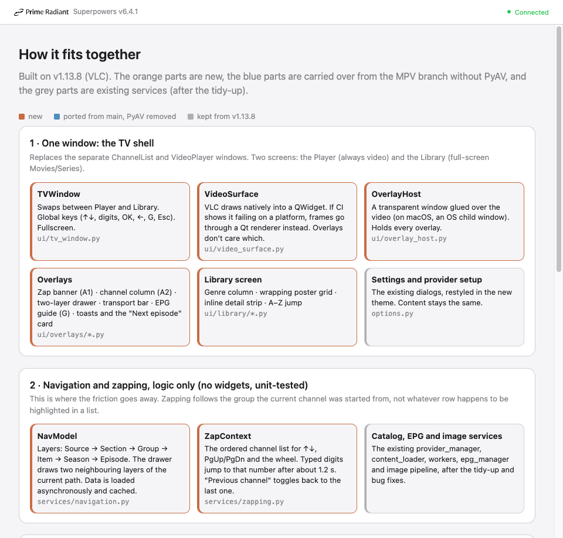

# QiTV: a TV-first player on VLC, with a pure-Python live pipeline

- **Date:** 2026-10-15
- **Status:** Design approved in conversation; written spec awaiting owner review
- **Branch:** `tv/vlc`, created from `16459ee` (v1.13.8, the last release without MPV)
- **Assets:** `docs/superpowers/specs/assets/2026-10-15-tv-on-vlc/` (approved mockups, spike measurements)

## 1. Intent

### What the owner asked for
- Start again from v1.13.8 (VLC). Stop building MPV: its native build and CI costs, its release complexity and its per-platform fragility outweigh its benefits. The owner liked MPV/uosc's look, its usability and how it handles live streams. They did not like that it runs as a separate macOS app outside QiTV's own window.
- Keep time-shift, but on VLC.
- Make the app "feel at home": a design that behaves like a regular TV. Changing channel must stop feeling like friction.
- Support near-real-time playback, so viewers can stay close to the satellite broadcast.
- Plan for PiP and swapping: during an ad, jump to another channel and come back.
- The app must run well on mid-range computers. People should be able to use it on the hardware they already have.
- Tidy the oddly written parts of the codebase.

### Success criteria
1. Changing channel with ↑/↓ starts the new channel immediately and shows a now/next banner. Fast repeated presses never open more streams than the provider allows.
2. Zapping always follows the channel's own group, whatever is highlighted elsewhere in the UI.
3. One window: video is the main screen, and everything else is an overlay or the full-screen library.
4. Live MPEG-TS channels can be paused, rewound and caught up (Go live) with no native build step. Time-shift uses RAM by default and disk after consent.
5. While "at live", playback stays within the chosen latency target of the pipeline's live edge, without user action.
6. On a 2017 quad-core i7 (the owner's Mac, used as the mid-range stand-in), playing 1080p50 or 4K50 with overlays visible costs at most about 1.5× the CPU of plain VLC, with no dropped frames.
7. The four packaging targets (Windows, Linux, Intel macOS, ARM macOS) pass automated playback smoke tests in CI.

### Assumptions (not stated by the owner, chosen during design)
- Providers (STB/Xtream/M3U), EPG, favorites, history and resume, exports, portable mode, and the external VLC/MPV modes all stay.
- Main (the MPV line, tag v1.14.1) stays untouched until release time; see §14.
- The TV shell uses a dark theme only, as TV interfaces generally do.

## 2. Decision log

| # | Decision | Why |
|---|---|---|
| D1 | Base on v1.13.8 / libVLC 3 from the official installers | No native compilation; the existing CI already packages VLC |
| D2 | Time-shift engine: **byte-level MPEG-TS segmenter in pure Python** (no PyAV/FFmpeg) | The owner rejected native builds; PyPI PyAV wheels would add GPL x264/x265, require macOS 14 on ARM and add about 60 MB |
| D3 | **Every live MPEG-TS channel goes through the pipeline**: RAM ring by default, disk ring after consent | Required for stay-live drift control, latency display, and pause/short rewind on every channel |
| D4 | **VLC draws natively; overlays live in a transparent window glued above the video.** If a platform fails CI, that platform falls back to Qt-drawn frames | Spike (§3): native rendering is much cheaper and does not stutter when the UI thread is busy |
| D5 | UI: a TV-first shell with a layered two-column drawer, uosc-style transport, and a full-screen Netflix-style library with a genre column | Approved through mockups (assets 01–05) |
| D6 | PiP and swap are delivered as Phase 4; sessions and surfaces support N ≥ 2 from Phase 1/2 | The owner switches channels during ads; providers limit concurrent streams |

## 3. Spike: drawing overlays on VLC (throwaway, macOS 13.7, i7-7820HQ, VLC 3.0.20)

The question was how to draw translucent overlays over VLC video: (A) native VLC output with a transparent top-level overlay window, or (B) libVLC frame callbacks (I420) with GPU YUV→RGB conversion in a `QOpenGLWidget` and overlays as child widgets. The clips were IPTV-like MPEG-TS files generated with ffmpeg. Process CPU is shown below, where 100% means one core (raw data in `spike-results.jsonl`).

| Clip (windowed) | VLC alone | A: native + overlay | B: Qt draws frames |
|---|---|---|---|
| 1080p50 H.264 8 Mb/s | 9.9% | 14.9% | 27.9% |
| 1080i50 H.264 (deinterlaced) | 20.5% | 26.0% | 35.9% |
| 2160p50 H.264 25 Mb/s | 12.2% | 17.2% | 61.4% |
| 2160p50 HEVC 20 Mb/s | 11.8% | 16.6% | 58.1% |

| UI thread blocked (1080p50) | A: VLC frames shown | B: frames painted |
|---|---|---|
| 30 ms of every 100 ms | 50.5 fps, 0 lost | 48.8 fps, 12 dropped |
| 60 ms of every 100 ms | **51.0 fps, 0 lost** | **30.0 fps, 200 dropped** |

Findings:
- Both approaches render identical overlays.
- The overlay window followed VLC into macOS native fullscreen without extra work.
- Approach B ties video smoothness to the Python UI thread, which rules it out as the default.
- Window-drag glue for A must be verified by hand; on macOS it will be attached as an NSWindow child window.
- Windows and Linux are unmeasured; CI decides whether either needs fallback B.

## 4. Architecture



### 4.1 Modules (new unless marked)
```
ui/
  tv_window.py          single top-level window; Player ↔ Library screens; global key routing; fullscreen
  theme.py              design tokens (§5.6) + Qt palette/stylesheet for dialogs
  video_surface.py      VideoSurface protocol; NativeVlcSurface (default); FrameSurface (fallback, built only if needed)
  overlay_host.py       transparent glued window (macOS child NSWindow; Win/X11 owned tool window); hosts overlays
  overlays/
    zap_banner.py       A1 now/next banner
    channel_column.py   A2 single column during fast zapping
    drawer.py           two-layer drawer (renders NavModel path)
    transport.py        uosc-style bar for live/time-shift/VOD; latency indicator
    guide.py            EPG grid overlay (G)
    toast.py            transient messages; "Next episode" card
  library/
    library_screen.py   genre column · wrapping grid · inline detail strip · A–Z jump
services/
  navigation.py         NavModel: layer path, async children loading, caching (no widgets)
  zapping.py            ZapContext: ordered channels, debounce, digit entry, previous channel (no widgets)
  playback.py           PlaybackSession (VLC player + optional live session + timeline + stay-live); SessionManager
  connection_budget.py  per-provider concurrent stream limit
  live/
    engine.py           parent-side supervisor of the long-lived helper process (ported from main's TimeshiftRecorder)
    worker.py           child process: sessions, source readers, segmenters, rings, loopback server
    source.py           raw TS over HTTP and HLS (ported from main's timeshift_source.py; PyAV removed)
    ts.py               188-byte packet parsing, PAT/PMT, PES PTS, keyframe detection, segment cutting
    ring.py             RAM ring and disk ring (disk ported from main: sessions, locks, leases, allocation units)
    server.py           token-protected loopback HTTP server; progressive /stream/N.ts
    timeline.py         continuous timeline from PTS with discontinuity handling
    stay_live.py        latency controller (pure logic, injected clock)
```
Existing modules stay and shrink. `channel_list.py` and its mixins stop being a window: their provider, catalog, link-creation, history, resume and export logic moves behind `services/` interfaces that the new UI calls. Old widgets (`video_player.py`, `widgets/sidebar.py`, `widgets/top_bar.py`, `mixins/display_mixin.py`) are deleted in Phase 3.

### 4.2 Data flow (live channel)
```
ZapContext.select(channel) ─► SessionManager.tune(main, channel)
   ├─ connection_budget.acquire(provider)            (waits for the old stream to close; never overlaps)
   ├─ create_link(channel)                           (existing STB/Xtream/M3U logic, in a worker)
   ├─ live.engine.open(session, url, headers, verify_ssl, ring_cfg)
   │      worker: source ─► ts segmenter ─► ring ─► server   (events: ready, segment, live_edge, error)
   ├─ on "ready" (first PAT/PMT and first keyframe seen):
   │      VLC.play("http://127.0.0.1:<port>/<token>/<session>/stream/<seq>.ts", low-latency profile)
   └─ on failure/unsupported: VLC.play(original url, low-latency profile) + toast "Time-shift isn't available"
Timeline + StayLive tick at 4 Hz ─► Transport/latency indicator; set_rate / reopen as needed
```

### 4.3 Threading and processes
- The GUI thread does UI only. Catalog, EPG and image work keeps using the existing QThread workers and `ThreadCleanup`.
- **One long-lived live worker process** (multiprocessing *spawn*) starts in the background at app launch. It hosts every live session, so zapping never pays a process start. It is ported from main's supervisor, including its owner-death watchdog, Windows pipe-EOF handling and the bootstrap IPC that keeps credentials out of argv. Frozen builds call `multiprocessing.freeze_support()`.
- Inside the worker: one reader thread per session plus a threaded loopback HTTP server. All parsing runs off the GUI process's GIL.
- If the worker dies, the supervisor restarts it once and reopens the current sessions. A second failure in the same playback falls back to direct VLC.

## 5. User interface

All screens use the visual language of the approved mockups. Overlay sizes scale with the video area (as the mockups' `cqw` units do).

### 5.1 Player screen: overlays
| Overlay | Shown when | Content |
|---|---|---|
| A1 zap banner | each channel change; `I` | number, logo, name, LIVE, Now (title, time, progress), Next |
| A2 channel column | repeated ↑/↓ within 1 s | the ZapContext group, highlight follows; tunes after a 400 ms rest |
| Drawer | `OK`/`Enter`, click on video, the List control | two neighbouring layers of the NavModel path, with a breadcrumb for the layers above (asset 03) |
| Transport | mouse move, Space, ←/→, any media key | uosc-style bar (asset 04); fades after 3 s |
| Latency indicator | at the live edge with controls visible | "Stay live ● 0.9 s behind source"; green when on target, amber while catching up |
| Guide | `G` | EPG grid over the video: channels as rows, time as columns, now-line |
| Toasts / cards | events | errors, "time-shift unavailable", "Next episode in 10 s" |

### 5.2 Layers (NavModel)
`Source → Section → Group → Item → Season → Episode`
- **Source:** one per configured provider. The model allows a merged "All providers" source, but it ships in "Later" (§13).
- **Section:** Live TV, Movies, Series, Favorites, Continue watching, Search everything.
- **Group:** the provider's categories. Favorites and Recent are pinned on top, and typing filters the list (asset 02, option 1).
- **Item:** channels (Live) or titles (Movies/Series).
- In the drawer, ← goes up a layer and →/OK goes down (or plays). Esc closes the drawer.

### 5.3 Zapping and keys (Player screen, no overlay open)
| Input | Action |
|---|---|
| ↑ / ↓, PgUp / PgDn, Ch+ / Ch− | previous / next channel in ZapContext. The first press tunes immediately; repeated presses within 1 s open A2 and tune after a 400 ms rest |
| Mouse wheel | channel up/down (setting: *Mouse wheel = Channel / Volume*; default Channel). ⌘/Ctrl+wheel = volume |
| Digits | channel-number entry; tunes 1.2 s after the last digit (Xtream `num`, STB `number`, otherwise list position) |
| Backspace | previous channel (toggle) |
| OK / Enter / click | open the drawer at Group \| Item |
| ← / → | seek −10 s / +10 s (live with buffer, VOD) |
| Space | pause/play (live pause = time-shift) |
| `L` | Go live |
| `G` | guide · `I` info banner · `F` / double-click fullscreen · `M` mute · `+`/`−` volume |
| `P`, `S` (Phase 4) | PiP open/close, swap |
| Esc | close the top overlay → leave fullscreen |
| Mouse back/forward | drawer layer up/down (as in v1.13.8) |

ZapContext is set when a channel is played from a group, and stays put until another group's channel is played. The v1.13.8 "Keyboard/Remote Mode" setting is removed: its behaviour becomes the default.

### 5.4 Library screen (Movies/Series)
- Full screen with no live video behind it. Opening it stops live playback; *Back to TV* re-tunes the last channel.
- Layout (asset 05, option 1):
  - Top navigation: Live TV · Movies · Series · Search · Source.
  - Genre column with type-to-filter, and Continue / New / My list pinned.
  - **Wrapping** poster grid, never an endless row to the right.
  - The focused poster opens an **inline detail strip under its line** (Resume / Start over / ★), and the grid continues below.
  - A–Z jump rail for large genres.
- Keys: arrows move in the grid, ← from the first column focuses the genres, and OK plays.
- Series: OK opens Seasons → Episodes inside the same screen. Each episode shows resume progress, and the player gets Next-episode support.
- Posters load through the existing image pipeline (workers cache bytes; the GUI builds the pixmaps).

### 5.5 Transport (asset 04)
- **Live, time-shifted:**
  - The bar covers the buffered range, with EPG programme starts as ticks.
  - A hover bubble shows wall-clock time; the right side shows "−mm:ss behind live".
  - Controls: Go live, a speed chip (1× / 1.25× / 1.5× / 2×), and ⏮ to the programme start when buffered (otherwise the buffer start).
- **Live at the edge:** no bar, only the LIVE badge and the latency indicator.
- **VOD:** elapsed and remaining times, ±10 s, speed, audio/subtitle tracks, PiP, fullscreen, and Next for episodes.

### 5.6 Visual tokens (`ui/theme.py`)
| Token | Value |
|---|---|
| Canvas | `#0b0f14` |
| Panel | `rgba(8,11,15,.86)` |
| Raised panel | `#0e1217` |
| Text | `#eef2f6` |
| Muted text | 62% alpha |
| Accent (focus, progress) | `#e08a5f` |
| Brand | `#C96B43` |
| Live | `#d6453a` |
| OK | `#5fbf7a` |
| Warning | `#e0b24a` |

Other tokens: radius 10 px (cards) and 14 px (panels); system UI font. Focus is shown as an accent ring with a 22% accent fill. Settings and provider dialogs adopt the palette but keep their content.

### 5.7 Overlay host (D4)
- The host is a frameless, translucent window that does not take activation and tracks the VideoSurface's global rectangle:
  - **macOS:** attached as a child NSWindow (via `ctypes`/objc), so the OS moves it with the player.
  - **Windows:** an owned tool window, synced on move/resize.
  - **X11/XWayland:** a transient window. If no compositor is running, overlays use opaque panel colours.
- Input: overlays receive mouse and keyboard while visible. When none is visible, the host is click-through and keys go to TVWindow.
- Repaints: only regions that changed. Live progress updates at ≤ 4 Hz.
- **Fallback FrameSurface:** libVLC video callbacks (I420), a `QOpenGLWidget` with a YUV shader, and overlays as child widgets. It is implemented only for a platform that fails the overlay CI gate, and is selected per platform.

## 6. Live pipeline

### 6.1 Sources
- **Raw TS over HTTP(S):**
  - Streamed with `requests`, honouring the provider's user agent, cookies, redirects and the global SSL-verify setting.
  - 188-byte packets only. 192/204-byte packets and non-TS content are reported as *unsupported*, which triggers direct play.
- **HLS:**
  - Playlists are parsed with `m3u8`. The highest-bandwidth compatible variant is chosen (ported from main), and media playlists are reloaded live.
  - Segments are fetched in order; AES-128 is decrypted with `pycryptodomex` (prebuilt wheels on all four targets; `cryptography` ≥ 49 has no Intel macOS wheel). Only TS segments are supported; fMP4/byte-range segments mean *unsupported*.
- **Reconnects:** exponential backoff (0.5 s → 8 s, up to 6 tries) while VLC plays from the ring. If they all fail, the session reports an error.

### 6.2 TS segmentation (`ts.py`): no remuxing
- Resync on `0x47` every 188 bytes, and parse PAT, then the PMT of the first program.
- Video PID types: 0x1B H.264, 0x24 HEVC, 0x02 MPEG-2. Audio and subtitle PIDs are kept as-is.
- Keyframe detection:
  - The adaptation field `random_access_indicator` on a video PUSI packet.
  - Fallback if no RAI is seen within 6 s: scan the PES payload start for H.264 NAL 5/7, HEVC NAL 16–21/32, or the MPEG-2 sequence header.
- PTS (33-bit, wrap-aware) is read from video PES headers. Audio-only streams cut on audio PES boundaries.
- A segment is cut at a keyframe once it is ≥ 2.0 s long, with a forced cut at 10 s. Every segment starts with fresh PAT and PMT copies, so any segment is a valid start point for VLC.

### 6.3 Timeline (`timeline.py`)
- A segment's duration is the PTS delta between consecutive segment-start keyframes.
- **Discontinuity:** a negative delta, a delta > 5× target, or a missing PTS. The wall-clock arrival delta is used instead, so the timeline stays continuous and monotonic.
- **Live edge** = end of the last complete segment + the open segment's PTS progress.
- **Playback position** = start of the opened segment + the elapsed play time measured from VLC's `get_time()` deltas. If those jump by more than 1 s compared with wall clock × rate, wall clock × rate is used instead.

### 6.4 Rings (`ring.py`)
- **RAM ring (default, no consent):** 128 MiB per session, about 2 min at 8 Mb/s. Enough for pause, short rewind and stay-live.
- **Disk ring (after consent in Settings):** 256 MiB–16 GiB slider, default 2 GiB. Ported from main: session directories, owner markers and QLockFile, stale-session cleanup, allocation-unit accounting, a 64 MiB free-space reserve, and reader leases.
- Eviction is oldest-first by bytes. Leased segments are deleted when released. Closing a session frees its ring asynchronously.

### 6.5 Loopback server (`server.py`)
- Binds 127.0.0.1 on a random port, with numeric bind (no reverse DNS; ported fix). Paths include a random 128-bit token.
- `GET /<token>/<session>/stream/<seq>.ts` is **progressive**: segments from `seq` onward, then the open segment's bytes **as they arrive** (condition variable), with no Content-Length (close-delimited).
- If the reader falls behind eviction, the connection closes; the session reopens at the oldest segment and shows "Rewound past the buffer".

### 6.6 VLC profile
- **Through the pipeline:** `:network-caching=300`, `:clock-jitter=0`, audio time-stretch **on** (the v1.13.8 `:no-audio-time-stretch` is removed), and `:ts-trust-pcr=0` because sources may carry broken PCR. Values are tuned against real channels in Phase 2.
- **Direct live (fallback):** low-latency caching. The v1.13.8 `:adaptive-logic=lowest` (always the lowest HLS quality) is removed, and HLS starts about 2 segments from live (`adaptive-livedelay`).
- **VOD:** v1.13.8's current settings are kept.
- The existing stall watchdog is kept and becomes session-aware.

### 6.7 Seeking and modes
| User action | Mechanism |
|---|---|
| Pause | VLC pause; the ring keeps filling |
| Rewind / seek / ⏮ | reopen at the segment containing the target (0.3–0.8 s); 2 s granularity |
| Speed | `set_rate` |
| Go live | reopen at `newest segment − latency target` |

States: **LIVE** (stay-live active) · **SHIFTED** (user paused or seeked back; no automatic catch-up) · **CATCHING_UP** (speed > 1× chosen while shifted; automatically returns to LIVE at the target).

### 6.8 Stay-live (`stay_live.py`, pure logic)
- **Setting *Live latency*:** Low (target 1.0 s behind our live edge) · Normal (2.5 s, default) · Stable (6 s). The provider's own delay behind satellite cannot be removed.
- **In LIVE:**
  - lag > target + 0.75 s → rate 1.05 (1.10 if lag > target + 3 s).
  - lag ≤ target + 0.2 s → rate 1.0.
  - lag > 20 s → reopen at live.
- Never faster than 1.10 in LIVE, and no adjustment while VLC is buffering.

### 6.9 Connection budget (`connection_budget.py`)
- **Limit per provider:**
  - Xtream: `user_info.max_connections` from the login response v1.13.8 already fetches.
  - STB and M3U: setting *Max simultaneous streams*, default 1 for STB and unlimited for M3U.
- Tuning releases the old stream before opening the new one. Rapid zapping is debounced (§5.3).
- Opening PiP beyond the limit asks whether to close the other stream.
- Provider 4xx responses that indicate a connection limit produce the message "Your provider allows N streams at a time".

## 7. Playback sessions and PiP

### Sessions
- A **PlaybackSession** combines a libVLC media player, a VideoSurface, an optional live session, a Timeline and a StayLive controller.
- **SessionManager** owns `main` and, from Phase 4, `pip`.
- The default is one VLC instance shared by the session players (to be confirmed in Phase 1).

### PiP and swap (Phase 4)
- **Open PiP:**
  - `P`: the previous channel goes into a small surface (25% width, snaps to the corners).
  - From the drawer: "Open in PiP".
- **Swap (`S`):** exchanges the two surfaces' geometry and stacking. Neither stream restarts. Audio follows the large surface.
- **Coming back after an ad:** both sessions keep their own ring, so swapping back shows "−3:20". The user can Resume (SHIFTED) or Go live / catch up.
- **Mini player:** v1.13.8's "PiP mode" (the whole window shrinks to always-on-top) remains under that name on `Alt+P`.
- **Later:** separate QiTV windows (TVWindow instances sharing the services).

## 8. Startup and settings
- **Launch:** TVWindow opens and the live worker starts in the background.
- **Last channel:** setting *Start with last channel*, on by default. Tunes the last live channel once its provider is ready.
- **No providers configured:** a themed welcome screen opens provider setup (the existing form).

### Settings changes
- **Added:** *Live latency*, *Mouse wheel*, *Start with last channel*, and *Max simultaneous streams* (per provider).
- **Ported from main:** the time-shift disk consent and size slider.
- **Removed:** *Keyboard/Remote Mode*.

### Config migration
- Additive keys with defaults.
- The old `channel_list` and `video_player` window geometries map to `tv_window`, which takes the larger of the two.

## 9. Error handling
| Situation | Behaviour |
|---|---|
| Pipeline: unsupported source | Direct VLC play + toast, once per channel |
| Source stalls | Ring keeps playing; reconnect in the background; spinner at the edge; Retry card after the backoff is exhausted |
| Worker crash | Restart once and reopen sessions; then fall back to direct play |
| Link creation fails (STB token, Xtream auth) | Toast with the provider name; stay on the current channel |
| Connection limit | Message in §6.9; never retried automatically |
| Disk full / ring I/O errors | Session switches to the RAM ring + toast; disk consent remains |
| Overlay host unavailable (no compositor) | Opaque panels; functionality unchanged |
| Background errors | Logged via `logging`; never `print` or a silent `pass` |

Modal dialogs are reserved for consent, destructive actions and provider setup.

## 10. Bugs to fix in Phase 0 (found by the tidy-up pass; each gets a regression test)
1. STB handshake sends `prehash` as a Python set (`provider_manager.py:365`).
2. The image cache never adds new downloads to its size, so nothing is ever evicted. The eviction code also guesses extensions from a non-existent key and crashes on `None` entries (`image_manager.py:101,177`).
3. The EPG's "ends after midnight" `stop_time` correction is computed and then discarded (`epg_manager.py:182`).
4. Some paths use the global HTTPS preference instead of the per-provider one, or ignore it entirely (`playback_mixin.py:294`, `export_mixin.py:332`, `content_loading_mixin.py:446`).
5. STB cached exports build `…/c//play/live.php` URLs (`export_mixin.py:129,155`).
6. STB next-episode autoplay reads `season["episodes"]` instead of `"series"` (`playback_mixin.py:649,709`).
7. Remote M3U playlists with CRLF line endings leave `\r` in channel names (`services/m3u.py:29`).
8. The context menu calls `create_link` synchronously on the UI thread (`display_mixin.py:698`). This becomes moot once the module is replaced in Phase 3, but must not be carried over.

Line numbers refer to v1.13.8.

## 11. Testing and CI

### Unit tests (no network, no VLC)
- `ts.py`: PAT/PMT, RAI and NAL fallback, PTS wrap, forced cuts, PAT/PMT re-emission, rejection of 192-byte packets.
- `timeline.py`: discontinuities and monotonicity.
- `ring.py`: RAM and disk eviction, leases, stale-session cleanup (ported tests).
- `stay_live.py`: fake clock and all state transitions.
- `navigation.py`, `zapping.py`: debounce, digit entry, previous channel, ZapContext independence.
- `connection_budget.py`.
- Phase 0 bug regressions.

### Fixtures
`scripts/make_ts_fixtures.py` generates small committed clips with ffmpeg (a developer-only tool, never needed at build time):
- 320×180 H.264, HEVC and MPEG-2, each with and without RAI.
- A clip with a PTS reset, an audio-only clip, and an AES-128 HLS set.

### Integration
A local HTTP source paces the fixtures at real time into the worker. A test reader then verifies:
- contiguous, keyframe-aligned segments that start with PAT/PMT;
- progressive delivery at the live edge;
- reopening at an arbitrary segment.

### Player smoke (real libVLC, `scripts/smoke_tv.py`)
- Tune through the pipeline, with frames displayed.
- Pause, rewind, Go live and stay-live rate changes.
- Zapping between two fixture channels never opens more than one source.
- The overlay host's geometry matches the video surface after move, resize and fullscreen.
- Screenshots are kept as artifacts.

### CI
- The v1.13.8 workflow gains `unittest` plus the smoke tests on Windows, Linux (xvfb with a compositor), Intel macOS and ARM macOS, both from source and on the frozen app.
- A platform that fails the overlay gate switches to FrameSurface (D4).

### Manual compatibility (never in CI)
- A sample of the public iptv-org playlist, recording the share of channels accepted by the pipeline versus direct fallback.
- The owner's private provider, at most 2 concurrent streams, with credentials kept local only.

### Performance gate (owner's Mac)
- Overlays plus pipeline at 1080p50: ≤ 1.5× the CPU of VLC alone, 0 lost frames.
- Worker CPU ≤ 5% of a core at 8 Mb/s.

## 12. Delivery phases
Each phase gets its own implementation plan in `docs/superpowers/plans/` and leaves the branch runnable.

| Phase | Content | Exit criteria |
|---|---|---|
| 0 Foundation | Review and land the tidy-up (worktree `tidy/v1.13.8`); fix §10 with tests; theme tokens; `.gitignore` for `.superpowers/` and `.playwright-mcp/`; AGENTS.md plan | All tests green; mypy no worse than baseline on touched modules |
| 1 TV shell (Live TV) | TVWindow, NativeVlcSurface, OverlayHost, banner, column, drawer and NavModel, ZapContext, transport (VOD + plain live), settings changes. Old browser reachable from the menu for Movies/Series | Live zapping works end to end on macOS; overlay CI gate on 4 platforms |
| 2 Live pipeline | `services/live/*`, sessions, connection budget, time-shift transport, stay-live, latency setting, disk ring consent | Integration and smoke tests green on 4 platforms; manual iptv-org and provider checks |
| 3 Library and guide | Library screen, Series layers, Next-episode card, guide overlay; remove old windows and mixins' UI | **Release** (see §14) |
| 4 PiP and swap | Second session and surface, swap, PiP budget prompts | Smoke: two sessions, swap without restart |

## 13. Out of scope (later)
- Merged "All providers" source (the model is ready for it).
- Clock repair: rewriting PCR/PTS in the pipeline.
- B-style split browse view.
- A full Settings redesign.
- Multiple QiTV windows.
- fMP4 HLS time-shift.
- VLC 4 output callbacks.

## 14. Open decisions (at release time)
- **Version number.** Recommended: 2.0.0, since main already carries the v1.14.x MPV line.
- **What happens to `main`.** Either merge `tv/vlc` so it supersedes the MPV tree, or archive MPV under a branch. The owner decides at release; nothing changes on `main` before then.
